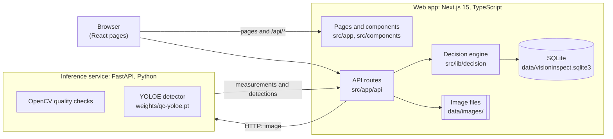
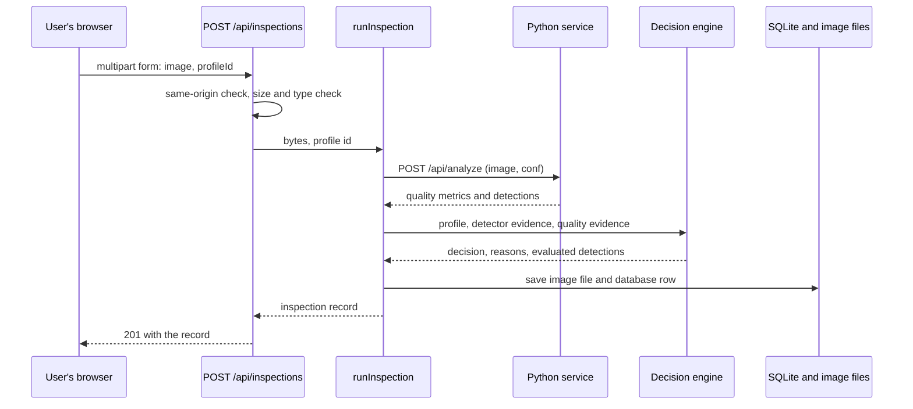
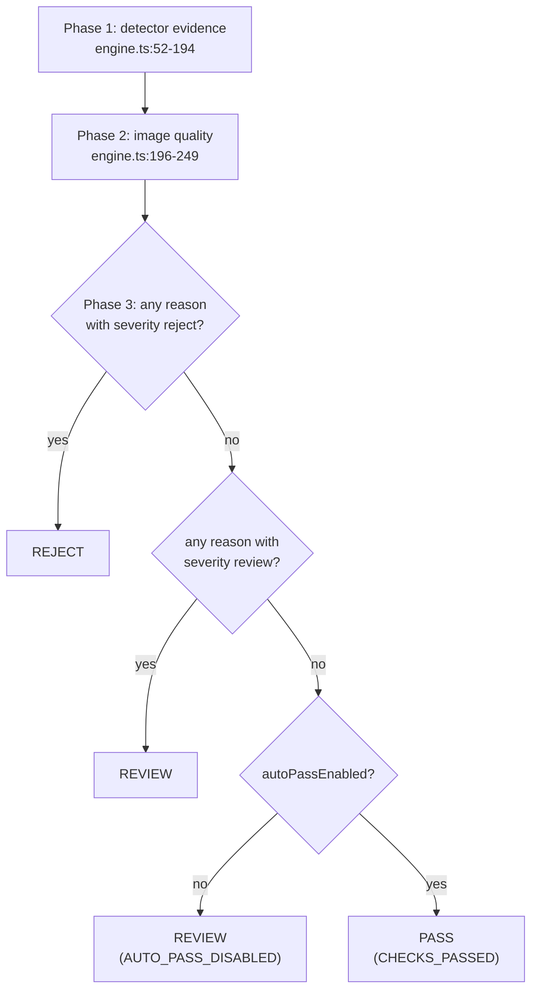
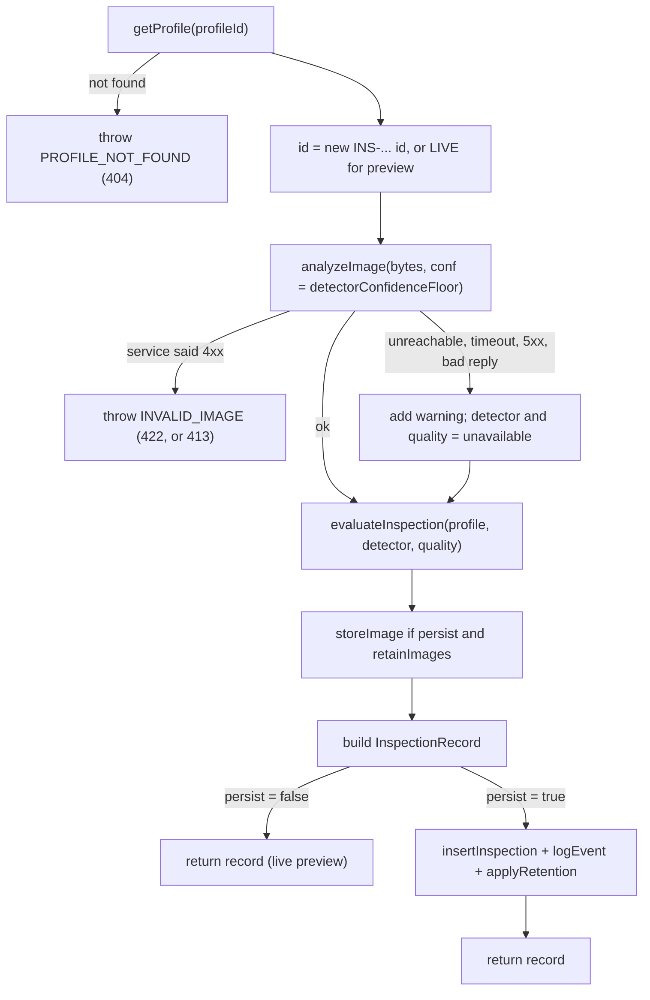
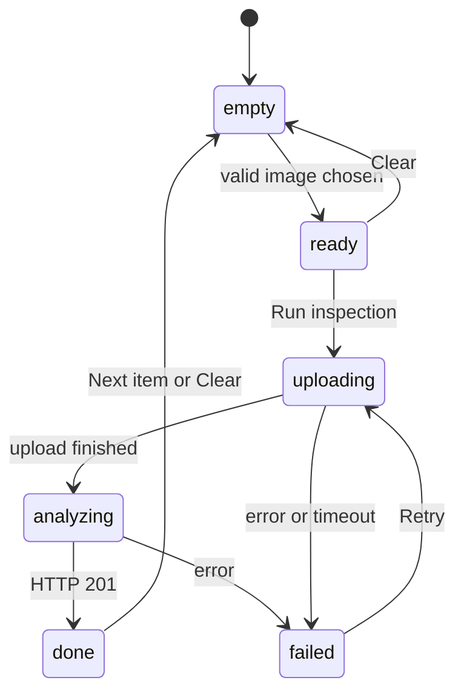
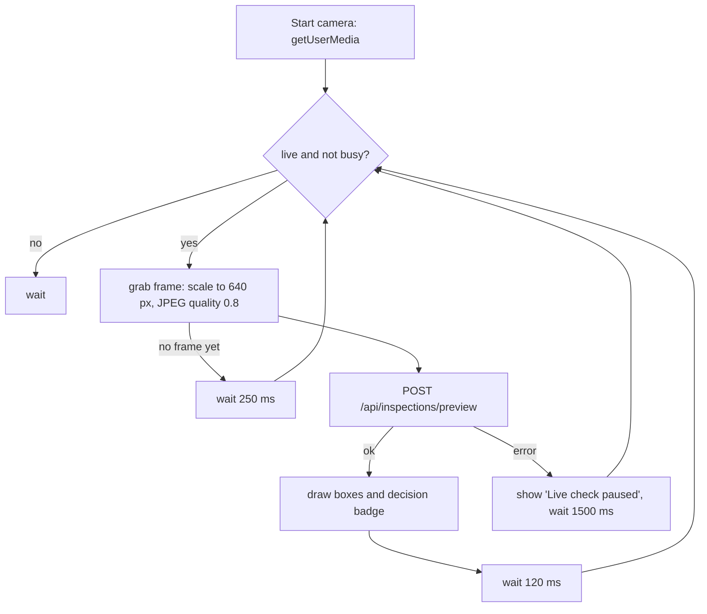

# VisionInspect Pro: Study Guide

A complete walkthrough of the project, written for a beginner. It starts with plain-language ideas and then goes through the code file by file.

**How the guide is built**

- Every claim about the code cites a file path and line numbers, like `src/lib/decision/engine.ts:48`. Line numbers match the repository as it was when this guide was written. If you edit a file, they will drift, so search for the function name instead.
- All paths are relative to the `visionpro/` folder, which is the repository root.
- Each part ends with "Check yourself" questions. Answers for the harder ones are in Part 6.
- Anything the guide could not confirm by reading code or running it is marked **Not verified**.

## Table of contents

1. [Part 1: The big picture](#part-1-the-big-picture)
2. [Part 2: Profiles and the decision engine](#part-2-profiles-and-the-decision-engine)
3. [Part 3: The Python inference service](#part-3-the-python-inference-service)
4. [Part 4: The web backend](#part-4-the-web-backend)
5. [Part 5: The frontend](#part-5-the-frontend)
6. [Part 6: Running, testing, deploying and limits](#part-6-running-testing-deploying-and-limits)

---

## Part 1: The big picture

### 1.1 What VisionInspect Pro is

VisionInspect Pro is a web application for **visual quality inspection**. You give it a photo of an item, either by uploading a file or by pointing a camera at it. It looks at the photo and answers one question: *is this item acceptable?*

The answer is one of three **decisions**:

| Decision | Meaning |
| --- | --- |
| **PASS** | The expected item is clearly in the photo, nothing is wrong, and the photo is good enough to trust. |
| **REJECT** | Something is definitely wrong. For example, a different item is in the photo, the expected item is missing, or a burn mark is visible. |
| **REVIEW** | The system is not sure. A human should look. For example, the item is only weakly detected, or the photo is too blurry. |

The key idea is that the decision is **explained**. Along with PASS, REJECT or REVIEW, you get a list of reasons, and each reason names the rule that produced it. The project calls this "explainable AI". The README describes it as "explainable AI for industrial quality inspection" (`README.md:3-6`).

Every inspection is saved, so you can search the history, export it as CSV or JSON, view charts, and print a report.

### 1.2 The problem it addresses

On a production line, someone has to check that each item is the right item and is undamaged. People get tired and make mistakes. Cameras and AI can check every item the same way every time.

But a bare AI answer such as "reject" is hard to trust. A person on the line asks "why?". This project is built around answering that question. The AI model only *measures and detects*. A separate set of readable rules, written in ordinary code, turns those measurements into the decision. Because the rules are separate from the model, you can read them, change the thresholds, and test them.

### 1.3 Beginner glossary

You will see these words throughout the guide. Part 6 has a longer glossary.

| Term | Plain meaning |
| --- | --- |
| **Object detection** | An AI task. The input is a picture. The output is a list of things the AI found, each with a *label*, a *box* showing where it is, and a *score*. |
| **Bounding box** | A rectangle around a detected object, stored as four numbers: `x1, y1` (top-left corner) and `x2, y2` (bottom-right corner), in pixels. |
| **Confidence score** | A number from 0 to 1 that the model gives each detection. Higher means the model is more sure. It is **not** a true probability. The README says so directly (`README.md:189`). |
| **YOLO** | "You Only Look Once". A popular family of fast object-detection models. It looks at the whole image once and outputs all its boxes. |
| **YOLOE** | A YOLO variant from Ultralytics that can look for things described in words or by example photos, without being retrained. Part 3 explains it. |
| **Threshold** | A cut-off number. For example, "a score of 0.35 or more counts as sure". The project keeps thresholds in the product profile. |
| **OpenCV** | A widely used library for image processing. Here it measures the photo itself: how sharp, how bright. |
| **Image quality check** | A check on the photo, not on the item. A blurry or very dark photo cannot be trusted, even if the item looks fine. |
| **API** | A way for one program to ask another to do something over the network, usually with HTTP requests. |
| **Frontend / backend** | The frontend is what runs in your browser (buttons, pages). The backend is the server code that does the work and stores data. |
| **SQLite** | A small database that lives in a single file. No separate database server is needed. |
| **Profile** | In this project, a saved set of rules for one kind of item: which item is expected, which thresholds to use, which checks are on. |

### 1.4 The profile idea

A **product profile** tells the system what "good" means for one kind of item. Three ready-made profiles ship with the app, plus an older one:

| Profile | Expected item | Extra check |
| --- | --- | --- |
| **Bottle** (`qc-bottle`) | a bottle | none |
| **Mobile charger** (`qc-charger`) | a phone charger | burn mark detection |
| **Marker** (`qc-marker`) | a marker pen | none |
| **Hot-rolled steel strip** (`neu-det-steel`) | steel surface defects | six defect classes (older, kept for trained weights) |

The Bottle profile passes a photo when the bottle is clearly in frame, no other supported product is in frame, and the photo is sharp and well lit. The same photo under the Charger profile is a REJECT, because a charger is expected and none is there. This is shown in the test run described in Part 6.

Part 2 covers the profiles and every rule in detail.

### 1.5 Architecture

There are two programs. They are started separately and talk to each other over HTTP.



Important consequences of this design:

- **The browser only talks to the Next.js server.** The address of the Python service is server-side configuration and the browser never needs it (`README.md:35-36`).
- **The Python service returns raw measurements only.** It reports "sharpness number 312" and "bottle at box (10,20,300,400), score 0.98". It does not say pass or fail.
- **The TypeScript decision engine applies the rules.** It compares those measurements with the thresholds in the profile and produces the decision and the reasons (`src/lib/decision/engine.ts`).
- **Each saved inspection includes a copy of the profile used at the time** (`profileSnapshot`, `src/lib/types.ts:143-166`). If you later edit a profile, old records still show the rules that were actually applied.

### 1.6 One inspection from start to finish

This is the path of a single uploaded photo. Each step is explained in detail later.



Two details worth knowing now:

- If the Python service is down, the web app does **not** fail. It stores the inspection as **REVIEW** with a warning, because no automatic decision is possible (`README.md:216`).
- The **live camera** uses a sibling route, `POST /api/inspections/preview`. It runs the same analysis and decision but stores nothing and uses the placeholder id `LIVE`.

### 1.7 The technology stack

**Web app (Node.js and TypeScript)**

| Piece | What it is | Why it is used here |
| --- | --- | --- |
| Next.js 15 (`next`) | A framework built on React that handles pages, routing and server code in one project. | One codebase serves the pages and the `/api/*` routes. |
| React 19 | A library for building user interfaces from components. | All the UI. |
| TypeScript 5.9 | JavaScript with types. | Catches mistakes before running. `strict` is on (`tsconfig.json:7`). |
| Tailwind CSS 4 | A CSS tool where you style with small utility class names. | Styling (`postcss.config.mjs`). |
| better-sqlite3 | A fast SQLite driver for Node. | Storing profiles, inspections and settings. |
| zod | A library that checks data against a schema at run time. | Validating request input and the Python service's response. |
| lucide-react | An icon set. | Icons in the UI. |
| vitest and Testing Library | Test runner and React testing helpers. | The unit, API and UI tests. |
| ESLint | A code style and bug checker. | `npm run lint`. |

Versions are in `package.json:1-47`.

**Inference service (Python)**

| Piece | What it is | Why it is used here |
| --- | --- | --- |
| FastAPI and uvicorn | A Python web framework and the server that runs it. | The HTTP API of the inference service. |
| OpenCV (`opencv-python-headless`) | Image processing library (the "headless" build has no windows). | Decoding images and measuring quality. |
| NumPy | Fast arrays. | Images are arrays of numbers. |
| Ultralytics | The library that provides YOLO and YOLOE. | Running the detector. |
| PyTorch | A deep-learning framework. | Ultralytics runs on it. |
| pytest | A Python test runner. | Tests for the service. |

Requirements files: `inference/requirements.txt`, `requirements-model.txt` and `requirements-dev.txt`.

**Other tools**

- **Docker** packages each program with everything it needs so it runs the same anywhere. Part 6 covers the Dockerfiles.
- **Git LFS** (Large File Storage) is a Git add-on for big files. The model file is about 71 MB, so it is stored with LFS. In a normal clone the file is a tiny text "pointer" until you run `git lfs pull` (`.gitattributes:2`, `README.md:20`).

### 1.8 Repository map

This is the `visionpro/` folder. Items marked *(local)* are created on your machine and are not in Git.

```text
visionpro/
├── README.md                 Project overview and setup (the original docs)
├── package.json              Node dependencies and npm scripts
├── package-lock.json         Exact dependency versions
├── tsconfig.json             TypeScript settings; "@/..." means "src/..."
├── next.config.ts            Next.js settings
├── eslint.config.mjs         Lint rules
├── postcss.config.mjs        Tailwind plugin
├── vitest.config.ts          Test runner settings
├── Dockerfile                Container image for the web app
├── docker-compose.yml        Runs web + inference together
├── render.yaml               Deployment blueprint for Render
├── .env.example              Template listing every setting
├── .env.local                (local) your copy of the settings
├── .gitattributes            Tells Git to use LFS for the model file
├── .gitignore / .dockerignore  Files to leave out of Git / Docker images
├── next-env.d.ts             (local, generated) Next.js type hints
├── node_modules/             (local) installed JavaScript packages
├── .next/                    (local) build output of Next.js
├── data/                     (local) SQLite database and saved images
│   ├── visioninspect.sqlite3
│   └── images/YYYY/MM/<id>.jpg
├── docs/
│   └── STUDY_GUIDE.md        This document
├── scripts/
│   ├── inference.mjs         Starts the Python service (npm run inference)
│   └── inference-test.mjs    Runs the Python tests (npm run test:inference)
├── src/                      The web app (Parts 2, 4, 5)
│   ├── middleware.ts         Optional site password
│   ├── app/                  Pages and API routes
│   ├── components/           Reusable UI pieces
│   ├── lib/                  Business logic, database, helpers
│   └── test/empty.ts         Stand-in for "server-only" in tests
└── inference/                The Python service (Part 3)
    ├── app/                  main.py, config.py, detector.py, quality.py
    ├── tools/                build_qc_model.py, clip_shim.py
    ├── tests/                test_api.py, test_vocabulary.py
    ├── weights/              qc-yoloe.pt, vocabulary.json, references/
    ├── requirements*.txt     Python dependencies
    ├── Dockerfile            Container image for the service
    ├── pytest.ini
    └── .venv/                (local) Python virtual environment
```

Inside `src/`:

- `src/app/` holds one folder per page: `dashboard`, `inspection`, `history`, `analytics`, `models`, `products`, `reports`, `settings`. It also holds `api/`, `layout.tsx`, `globals.css`, `loading.tsx`, `error.tsx` and `not-found.tsx`.
- `src/components/` is grouped by area: `shell`, `inspection`, `history`, `charts`, `dashboard`, `models`, `products`, `reports`, `settings`, `ui`.
- `src/lib/` holds `decision/`, `db/`, `inference/`, `services/`, `storage/`, `profiles/`, `models/` and loose helpers (`types.ts`, `classes.ts`, `validation.ts`, `upload.ts`, `api.ts`, `export.ts`, `analytics.ts`, `format.ts`).

### 1.9 How the three Git commits fit

The repository has three commits: `Initial commit`, `Add VisionInspect Pro app with deployment setup`, and `Prepare Render free deployment with tunnelled inference`. The project is therefore a single application that was then prepared for deployment, not a long history of experiments.

### 1.10 Check yourself: Part 1

1. Which program decides PASS, REJECT or REVIEW: the Python service or the web app?
2. Why does the guide say a confidence score is not a probability?
3. What happens to an inspection if the Python service is unreachable?
4. Why is the model file stored with Git LFS, and what do you see if you forget `git lfs pull`?
5. Why does each saved inspection contain a copy of the profile?
6. What is different about `POST /api/inspections/preview` compared with `POST /api/inspections`?

---

## Part 2: Profiles and the decision engine

This is the heart of the project. If you understand this part, you understand *what the product actually decides* and why. The code is small (281 lines in `src/lib/decision/engine.ts`) and has no dependencies on the web, the database or the model, which is why it is easy to test.

### 2.1 The data the engine works with

All shared types live in `src/lib/types.ts`. These are the ones the engine uses.

**A detection** (`types.ts:12-19`) is one thing the model found:

```ts
interface Detection {
  classId: number;      // the model's internal number for the class
  className: string;    // e.g. "bottle"
  confidence: number;   // 0..1, raw model score
  box: Box;             // {x1, y1, x2, y2} in pixels
  label?: string;       // only for "out_of_range": what the model thought it was, e.g. "cup"
}
```

**A class rule** (`types.ts:21-36`) says how to treat one class inside a profile:

| Field | Meaning |
| --- | --- |
| `key` | Normalised class name such as `rolled_in_scale`. |
| `label` | Name shown to people. |
| `enabled` | If false, detections of this class are recorded but ignored. |
| `role` | `"defect"` (the default) or `"required"`. |
| `rejectThreshold` | For a **defect**: score at or above this means REJECT. For a **required** product: score at or above this *confirms* the product is present. |
| `reviewThreshold` | For a **defect**: score at or above this (but below reject) means REVIEW. For a **required** product: the lowest score still counted as an uncertain sighting. |

**Quality rules** (`types.ts:38-48`):

| Field | Meaning |
| --- | --- |
| `enabled` | Turn all photo-quality checks on or off. |
| `minBlurVariance` | The photo's focus number must be at least this. |
| `minBrightness`, `maxBrightness` | Average brightness (0 to 255) must be within this range. |
| `minWidth`, `minHeight` | Smallest allowed photo size in pixels. |
| `maxOverexposedFraction` | The share of near-white pixels (value 245 or more) must not exceed this. |

**A product profile** (`types.ts:50-63`) bundles it all: `id`, `name`, `code`, `domain`, `modelId`, `notes`, `autoPassEnabled`, `classes` (a list of class rules), `quality` and timestamps.

**Evidence** is what the engine is handed:

- `DetectorEvidence` (`types.ts:88-103`) is either `status: "ok"` with the model id, the detections and timings, or `status: "unavailable" | "error"` with a message.
- `QualityEvidence` (`types.ts:77-79`) is either `status: "ok"` with the measured metrics (`QualityMetrics`, `types.ts:65-75`) or a not-ok status with a message.

**The result** (`DecisionResult`, `types.ts:123-127`) holds the `decision`, a list of `reasons`, and the list of `detections` each tagged with an `outcome`.

A **reason** (`types.ts:107-114`) has a `code` (machine name), a `severity` (`"reject"`, `"review"` or `"info"`), a human `message`, an optional `rule` sentence that names the configured rule, and an optional `detectionIndex` that points to the box it refers to. The `rule` sentence is what makes the decision explainable.

A detection **outcome** (`types.ts:116`) is one of: `reject`, `review`, `below_threshold`, `class_disabled`, `unknown_class`, `present`, `out_of_range`.

### 2.2 Class names are normalised

Different tools write class names differently (`rolled-in_scale`, `Rolled In Scale`). The helper `classKey()` (`src/lib/classes.ts:4-10`) lowercases the name, replaces every run of characters that are not letters or digits with one underscore, and trims underscores from the ends. So `"rolled-in_scale"` becomes `rolled_in_scale`. The engine applies it to every detector class name and to model ids, so `"yoloe-qc"` and `"YOLOE QC"` count as the same model.

### 2.3 The built-in profiles

Defined in `src/lib/profiles/defaults.ts`. They are only starting values. The file's comment says so: they are "not values derived from a calibration study" (`defaults.ts:4-7`).

**Default quality rules** (`defaults.ts:8-16`)

| Rule | Value |
| --- | --- |
| Quality checks enabled | yes |
| Minimum focus (Laplacian variance) | 50 |
| Brightness range | 30 to 225 |
| Minimum size | 128 x 128 px |
| Maximum clipped highlights | 25% (0.25) |

**Steel profile** (`defaultSteelProfile`, `defaults.ts:20-40`)

- `id` `neu-det-steel`, name "Hot-rolled steel strip", code `STEEL-NEU-01`, model id `yolov8n-neu-det`.
- Six classes from `NEU_DET_CLASSES` (`classes.ts:14-21`): crazing, inclusion, patches, pitted surface, rolled-in scale, scratches. NEU-DET is a public dataset of steel surface defects.
- Each class: enabled, **review 0.25, reject 0.50**, role defaults to `defect`.
- Uses the default quality rules.
- This profile needs a model trained on NEU-DET. The shipped model (`yoloe-qc`) does not know these classes, so this profile mainly exists for the "model mismatch" case (see 2.5).

**Category profiles** (`defaultCategoryProfiles`, `defaults.ts:85-103`)

All three use model id `yoloe-qc` (`defaults.ts:43`) and the same domain text. They are built by one function, `categoryClasses(category)` (`defaults.ts:74-83`), so every profile lists all four classes the model can report. The rules differ by which product the profile is for:

| Class in the profile | Role in the profile | Review | Reject | Enabled |
| --- | --- | --- | --- | --- |
| The profile's **own** product | `required` | 0.12 | 0.35 | yes |
| Each **other** product (labelled "Wrong item: ...") | `defect` | 0.35 | 0.55 | yes |
| `burn_mark` | `defect` | 0.30 | 0.50 | only for the Charger profile |

So the three profiles are:

| Profile | id | Code | Required | Wrong items | Burn mark |
| --- | --- | --- | --- | --- | --- |
| Bottle | `qc-bottle` | `BOTTLE-01` | bottle | charger, marker | disabled |
| Mobile charger | `qc-charger` | `CHARGER-01` | charger | bottle, marker | **enabled** |
| Marker | `qc-marker` | `MARKER-01` | marker | bottle, charger | disabled |

(`CATEGORY_DEFECTS` at `defaults.ts:55-59` is the table that turns burn mark on only for chargers.)

**Category quality rules** (`CATEGORY_QUALITY`, `defaults.ts:65-72`) are looser than the defaults:

| Rule | Default | Category profiles | Why |
| --- | --- | --- | --- |
| Min focus | 50 | **15** | Smooth plastic or metal has little texture, so its focus number is naturally low. |
| Min size | 128 x 128 | **100 x 100** | Allows smaller photos. |
| Max brightness | 225 | **245** | Catalogue-style photos on white backgrounds are normal. |
| Max clipped highlights | 0.25 | **0.80** | Same reason. |

(Min brightness stays 30.)

**Why is the "required" threshold so low (0.12)?** Because the model is shared by several products and its scores for the right item are often modest. The project would rather ask a human (REVIEW, between 0.12 and 0.35) than falsely reject a real product.

### 2.4 How the engine decides: the big picture

`evaluateInspection({ profile, detector, quality })` (`engine.ts:48`) runs three phases and fills a list of reasons as it goes:



Two rules to remember:

1. **Precedence is REJECT, then REVIEW, then PASS** (`engine.ts:252-255`). One reject reason makes the whole result REJECT, even if there are many review reasons.
2. **Every reason that applies is recorded**, even ones that do not decide the outcome. The operator therefore sees all the evidence.

Reasons with severity `info` never change the decision.

### 2.5 Phase 1: detector evidence (`engine.ts:52-194`)

**If the detector is not "ok"** (`engine.ts:53-62`), the engine adds one review reason and checks nothing else about detections:

- `MODEL_UNAVAILABLE` if status is `unavailable` (weights missing, service down).
- `MODEL_ERROR` if status is `error`.

The result can then never be PASS or REJECT from detector evidence, which is deliberate: without a detector, nobody can say the item is good.

**If the detector is "ok"**, the engine does these things in order.

**(a) Model check** (`engine.ts:64-71`). If `classKey(detector.modelId)` differs from `classKey(profile.modelId)`, it adds `MODEL_MISMATCH` (review). A profile is tied to the model it was made for. This is why the steel profile (`yolov8n-neu-det`) used with the shipped model (`yoloe-qc`) always goes to REVIEW.

**(b) One pass over each detection** (`engine.ts:72-136`). The engine builds a lookup from class key to class rule. For each detection it normalises the class name and picks the *first* matching branch:

| Order | Condition | Outcome | Reason (severity) |
| --- | --- | --- | --- |
| 1 | class is `out_of_range` and the profile has no rule for it | `out_of_range` | none yet (judged later in step c) |
| 2 | no rule for the class | `unknown_class` | `UNKNOWN_CLASS` (review) |
| 3 | rule exists but `enabled` is false | `class_disabled` | `CLASS_DISABLED` (info) |
| 4 | rule role is `required` | `present` | none yet (judged per class in step c) |
| 5 | score >= `rejectThreshold` (inclusive) | `reject` | `DEFECT_REJECT` (reject) |
| 6 | score >= `reviewThreshold` | `review` | `DEFECT_AMBIGUOUS` (review) |
| 7 | otherwise | `below_threshold` | `BELOW_THRESHOLD` (info) |

The reject threshold is **inclusive**: a score of exactly 0.50 rejects when the threshold is 0.50 (test at `engine.test.ts:64-67`).

**(c) Required products** (`engine.ts:138-193`). Presence is judged once per required class, using the **best** (highest-score) sighting of it.

Before that, the engine works out `knownInView` (`engine.ts:140-143`): *is anything the profile knows about visible at review level or above?* A detection counts if its class has an **enabled** rule and its score is at least that rule's `reviewThreshold`. Note that "wrong item" products count here, because they are configured classes. Everyday objects (`out_of_range`) and unknown classes do not.

Then, for each enabled required class, the first matching case wins:

| Order | Condition | Reason | Severity |
| --- | --- | --- | --- |
| 1 | best score >= `rejectThreshold` | `PRODUCT_PRESENT` | info |
| 2 | best score >= `reviewThreshold` | `PRODUCT_UNCERTAIN` ("only weakly detected, confirm manually") | review |
| 3 | not found, and **nothing known** is in view | `OUT_OF_RANGE` | **reject** |
| 4 | not found, but something known (another product) is in view | `PRODUCT_MISSING` | **reject** |

`OUT_OF_RANGE` (`engine.ts:168-184`) is only reported once even if several required classes exist. It tries to be helpful: it collects the `out_of_range` detections with a score of at least `OUT_OF_RANGE_NAME_MIN` = 0.35 (`engine.ts:44`), sorts them by score, takes up to three distinct names, and writes a message such as:

> Out of range: the item in view is not a supported product (closest match: a cup; expected Bottle).

If there is no such named object, the message is "no supported product was recognised in view (expected Bottle)". The helper `withArticle` adds "a" or "an".

### 2.6 What "out of range" means

The shipped detector has a special class, `out_of_range`, for everyday objects that are *not* a supported product (a cup, a book, keys). It exists so that a cup does not get forced into the nearest product class. Part 3 explains how it is produced.

In the engine, `out_of_range` detections are **ignored when the expected product is present** (the test "ignores everyday objects next to the expected product", `engine.test.ts:203`). They only matter when the expected product is *not* found and no other supported product is visible. Then the item is reported as out of range, which is a REJECT.

The UI shows the words **OUT OF RANGE** on the badge instead of REJECT for such results. This is purely a relabel: `decisionLabel()` (`classes.ts:43-45`) returns "OUT OF RANGE" if any reason has the code `OUT_OF_RANGE`, and the badge uses it (`ResultPanel.tsx:147`, `LiveCamera.tsx:248`, `report/page.tsx:54`). **The stored decision remains REJECT.**

### 2.7 Phase 2: image quality (`engine.ts:196-249`)

These checks only run if `profile.quality.enabled`. All of them produce **review** reasons, never reject: a bad photo means "get a better photo", not "the item is bad".

| Code | Triggers when | Rule text |
| --- | --- | --- |
| `QUALITY_UNAVAILABLE` | quality evidence is not ok | quality checks are enabled |
| `QUALITY_RESOLUTION` | width < `minWidth` or height < `minHeight` | minimum size |
| `QUALITY_BLUR` | `blurVariance` < `minBlurVariance` | variance of Laplacian at least the minimum |
| `QUALITY_DARK` | `brightnessMean` < `minBrightness` | too dark |
| `QUALITY_BRIGHT` | `brightnessMean` > `maxBrightness` | too bright |
| `QUALITY_CLIPPED` | `overexposedFraction` > `maxOverexposedFraction` (strictly greater) | too many blown-out pixels |

If quality checks are turned off, unavailable quality evidence is ignored (test `engine.test.ts:120-128`).

### 2.8 Phase 3: the outcome (`engine.ts:251-273`)

1. Any `reject` reason: **REJECT**.
2. Else any `review` reason: **REVIEW**.
3. Else if `autoPassEnabled` is false: add `AUTO_PASS_DISABLED` and return **REVIEW**. This lets a profile require a human to confirm every clean result.
4. Else add `CHECKS_PASSED` and return **PASS**.

### 2.9 Every reason code in one table

| Code | Severity | Set by |
| --- | --- | --- |
| `MODEL_UNAVAILABLE` | review | detector status `unavailable` |
| `MODEL_ERROR` | review | detector status `error` |
| `MODEL_MISMATCH` | review | running model differs from profile's model |
| `UNKNOWN_CLASS` | review | detection with no matching rule (and not `out_of_range`) |
| `CLASS_DISABLED` | info | detection of a disabled class |
| `DEFECT_REJECT` | reject | defect score >= reject threshold |
| `DEFECT_AMBIGUOUS` | review | defect score in the review band |
| `BELOW_THRESHOLD` | info | defect score under the review threshold |
| `PRODUCT_PRESENT` | info | required product at or above its reject (confirm) threshold |
| `PRODUCT_UNCERTAIN` | review | required product between its review and reject thresholds |
| `OUT_OF_RANGE` | reject | required product missing and nothing known in view |
| `PRODUCT_MISSING` | reject | required product missing but another known product in view |
| `QUALITY_UNAVAILABLE` | review | quality evidence missing |
| `QUALITY_RESOLUTION` | review | photo too small |
| `QUALITY_BLUR` | review | photo not sharp enough |
| `QUALITY_DARK` | review | photo too dark |
| `QUALITY_BRIGHT` | review | photo too bright |
| `QUALITY_CLIPPED` | review | too many clipped highlights |
| `AUTO_PASS_DISABLED` | review | profile requires confirmation |
| `CHECKS_PASSED` | info | everything fine |

### 2.10 The confidence floor

`detectorConfidenceFloor(classes)` (`engine.ts:277-281`) tells the Python service the lowest score worth returning. It is the smallest `reviewThreshold` among **enabled** classes, defaulting to 0.25 when none is enabled, clamped to between 0.01 and 1. The reason: if the engine only acts on scores of 0.12 or more, there is no point asking the model for anything below that. The web layer passes this value as `conf` (see Part 4).

For the Bottle profile the enabled review thresholds are 0.12 (bottle), 0.35 (charger), 0.35 (marker), and burn mark is disabled, so the floor is **0.12**.

### 2.11 Worked examples

Assume the photo quality is good. Profile is **Bottle** unless stated. These match the tests in `src/lib/decision/engine.test.ts`.

| # | Detections (class, score) | What happens | Result |
| --- | --- | --- | --- |
| 1 | bottle 0.80 | 0.80 >= 0.35, so `PRODUCT_PRESENT` | **PASS** |
| 2 | (nothing) | Bottle not found, nothing known in view: `OUT_OF_RANGE` | **REJECT** |
| 3 | bottle 0.20 | 0.12 <= 0.20 < 0.35: `PRODUCT_UNCERTAIN` | **REVIEW** |
| 4 | bottle 0.05 | below 0.12, so it does not count as a sighting: `OUT_OF_RANGE` | **REJECT** |
| 5 | bottle 0.90 and charger 0.70 | charger is a wrong item, 0.70 >= 0.55: `DEFECT_REJECT` | **REJECT** |
| 6 | bottle 0.90 and out_of_range 0.60 | everyday object ignored, bottle present | **PASS** |
| 7 | out_of_range 0.44 labelled "cup" | no bottle, nothing known: `OUT_OF_RANGE`, "closest match: a cup" | **REJECT** (badge says OUT OF RANGE) |
| 8 | out_of_range 0.20 | too weak to name: "no supported product was recognised" | **REJECT** |
| 9 | charger 0.70 and out_of_range 0.60 | charger rejected as wrong item, and since a known item is in view the missing bottle is `PRODUCT_MISSING` | **REJECT** |
| 10 | charger 0.40 | charger is in its review band (0.35 to 0.55): `DEFECT_AMBIGUOUS`; bottle missing and charger is "known": `PRODUCT_MISSING` | **REJECT** (a review reason is also recorded) |

On the **Charger** profile:

| Detections | Result |
| --- | --- |
| charger 0.86 and out_of_range 0.46 | **PASS** (this is the real test run in Part 6) |
| charger 0.90 and burn_mark 0.60 | burn mark is enabled and 0.60 >= 0.50: **REJECT** |
| charger 0.90 and burn_mark 0.40 | burn mark in its review band (0.30 to 0.50): **REVIEW** |

On the **Bottle** profile, a `burn_mark` detection is recorded as `class_disabled` with an info reason and changes nothing.

On the **Steel** profile (the first tests in the file use it): `patches` at 0.30 is **REVIEW**, `patches` at 0.50 is **REJECT**, `scratches` at 0.81 is **REJECT**, and an unknown class such as `dent` at 0.90 is **REVIEW** (`UNKNOWN_CLASS`).

### 2.12 What the test file covers (`src/lib/decision/engine.test.ts`)

The tests build fake evidence with a helper (`detector()` at lines 21-35) and run `evaluateInspection`.

| Group | Tests (line) |
| --- | --- |
| Steel profile basics | clean result passes (39); reject at threshold (45); class name normalisation (52); review band (58); inclusive threshold (64); disabled classes recorded but ignored (69); unknown class reviewed (76) |
| Detector and model | unavailable detector never passes (82); model mismatch (93) |
| Quality | quality failures give review with rule text (99); missing quality evidence (111); quality rules disabled (120); reject beats quality warnings (130) |
| Profile settings | auto-pass disabled gives review (140) |
| Confidence floor | lowest enabled review threshold (152); clamp to 0.01 (156) |
| Required products (Bottle) | pass (166); missing gives out of range (173); weak gives review (179); everyday object only (183); nothing recognised (193); weak guesses not named (198); everyday object next to product (203); wrong product in view gives PRODUCT_MISSING (209); wrong product beside it rejects (215) |

Not tested: the burn-mark thresholds and the exact numbers in `defaults.ts`. **Not verified**: behaviour with several required classes in one profile (the default profiles only have one).

### 2.13 Check yourself: Part 2

1. A bottle is detected with score 0.30 in the Bottle profile. What is the decision, and which reason code explains it?
2. Why does `CLASS_DISABLED` have severity `info` rather than `review`?
3. In the Bottle profile, a charger scores 0.45 and no bottle is found. List the reason codes you expect and the final decision.
4. What is the difference between `OUT_OF_RANGE` and `PRODUCT_MISSING`? Both reject, so why keep both?
5. Why do the quality checks only ever produce REVIEW, never REJECT?
6. The profile for steel uses model id `yolov8n-neu-det`. What happens if you run it with the `yoloe-qc` model, and which line of the engine causes it?
7. The README calls scores "not calibrated probabilities". Give an example of why comparing a score of 0.35 to a threshold is still useful, and one reason to be careful.

---

## Part 3: The Python inference service

The folder `inference/` is a small, separate program. Its only job is: *receive one image, measure it, find objects in it, and reply with numbers*. It makes no decisions.

### 3.1 Concepts first

**What is FastAPI?** A Python framework for building web APIs. You write a function, mark it with `@app.post("/path")`, and FastAPI turns it into an HTTP endpoint. It also checks incoming fields (such as "this must be a number") for you.

**What is uvicorn?** The server program that actually listens on a network port and hands requests to FastAPI. You start it with `python -m uvicorn app.main:app`. That means "in the file `app/main.py`, run the object called `app`".

**What is a virtual environment (`.venv`)?** A private folder of Python packages for this project, so it does not interfere with other Python programs on your computer. `inference/.venv/` is yours and is not in Git.

**What is an image to a computer?** A grid of pixels. Each pixel is three numbers (blue, green, red, 0 to 255 each in OpenCV's order). A 640x480 photo is a 480 x 640 x 3 array of numbers. NumPy holds these arrays and OpenCV processes them.

**What is object detection, concretely?** The model takes the image array and returns rows like `bottle, 0.98, (265, 55, 550, 1010)`: a class name, a confidence and a box. It can return several rows for one photo, and several boxes may overlap.

**What is NMS (non-maximum suppression)?** Models often produce many overlapping boxes for one object. NMS keeps the best one and removes the others that overlap it too much. "Class-agnostic" NMS does this *across classes too*, so one object gets one label even if two classes both fired. The service turns that on (`detector.py:116`).

**What is IoU?** "Intersection over union": how much two boxes overlap, from 0 (not at all) to 1 (identical). It is the overlap area divided by the combined area. `_iou` is at `main.py:256-261`.

**What is YOLO?** A family of detectors that run the image through a neural network once. Normally the list of classes is fixed when the model is *trained* on thousands of labelled photos (for example the 80 everyday object types of the COCO dataset).

**What is YOLOE, and why does this project use it?** YOLOE ("Real-Time Seeing Anything") is an open-vocabulary YOLO-family model from Tsinghua University researchers, supported by Ultralytics ([Ultralytics docs](https://docs.ultralytics.com/models/yoloe), [paper](https://arxiv.org/html/2503.07465v2)). Instead of a fixed class list, it can be told what to look for *after* training, in two ways:

- **Text prompts**: describe the class in words, such as "stainless steel water bottle". A text encoder turns the phrase into a list of numbers (an *embedding*).
- **Visual prompts**: show an example photo with a box drawn around the item. The model turns that region into an embedding.

This is called **open-vocabulary detection**. The big benefit here is that there was **no training run**: nobody collected thousands of labelled photos. The project author wrote phrases and drew boxes on 15 photos (`weights/README.md:3-6`). The cost is accuracy: the README calls the result "a starting point, not a validated inspection system" (`README.md:17-20`).

**What are CLIP and MobileCLIP?** CLIP is a model family trained to place text and images in the same "number space", so a phrase and a matching picture land near each other. YOLOE's text path relies on a CLIP-style text encoder. Per `inference/weights/README.md:21` the MobileCLIP text encoder is downloaded by Ultralytics when you *rebuild* the model, and it is not committed. The running service does not need it, because the finished embeddings are already stored in `qc-yoloe.pt`.

### 3.2 File map

| File | Role |
| --- | --- |
| `app/config.py` (64 lines) | Reads settings from environment variables. |
| `app/main.py` (280 lines) | The HTTP API: endpoints, auth, errors, zoom-out pass. |
| `app/detector.py` (232 lines) | Loads the model, maps labels, runs predictions, warm-up. |
| `app/quality.py` (89 lines) | Decodes images and measures quality with OpenCV. |
| `tools/build_qc_model.py` (118 lines) | Offline script that builds `qc-yoloe.pt`. Not used at runtime. |
| `tools/clip_shim.py` (35 lines) | Helper so the build script does not need a GitHub-only package. |
| `weights/` | The model, the vocabulary, and reference photos. |
| `tests/` | `test_api.py` (223 lines), `test_vocabulary.py` (25 lines). |

### 3.3 Settings: `app/config.py`

`Settings` (`config.py:39`) is a frozen dataclass. Each field reads an environment variable when a `Settings()` object is created. `get_settings()` (`config.py:63`) creates one.

| Variable | Default | Meaning | Line |
| --- | --- | --- | --- |
| `VI_MODEL_PATH` | `weights/qc-yoloe.pt` | Path to the model file | 32 |
| `VI_VOCAB_PATH` | `weights/vocabulary.json` | Path to the label map | 36 |
| `VI_MODEL_ID` | `yoloe-qc` | Name reported to the web app, which compares it with the profile | 43 |
| `VI_MODEL_VERSION` | `11l-text-vp-v2` | Version string reported | 44 |
| `VI_IMGSZ` | `640` | Default input size for the model | 45 |
| `VI_WARMUP_IMGSZ` | `480` | Extra sizes to warm up (comma separated) | 49 |
| `VI_MAX_UPLOAD_MB` | `10` | Largest accepted upload | 52 |
| `VI_API_TOKEN` | not set | If set, every request must carry this token | 55 |
| `VI_CORS_ORIGINS` | `http://localhost:3000` | Browser origins allowed to call the service directly | 58 |

Two helpers make this forgiving. `_int()` (`config.py:12-16`) falls back to the default when a value is not a number. `_resolve()` (`config.py:19-28`) accepts paths relative to either `inference/` or the repository root, which is why `.env.example` can say `inference/weights/qc-yoloe.pt` while the default says `weights/qc-yoloe.pt`.

The `npm run inference` launcher copies `VI_*` lines from `.env` and `.env.local` into the service's environment (`scripts/inference.mjs:15-24`).

### 3.4 Image decoding and quality: `app/quality.py`

**Format check by signature.** `sniff_format()` (`quality.py:24-31`) looks at the first bytes of the file, not the filename or the declared type. A browser can claim any type, but the bytes do not lie:

| Format | First bytes |
| --- | --- |
| JPEG | `FF D8 FF` |
| PNG | `89 50 4E 47 0D 0A 1A 0A` (the byte `89` then the letters "PNG" and line-ending markers) |
| WebP | `RIFF` at bytes 0-3 and `WEBP` at bytes 8-11 |

**Decoding.** `decode_image()` (`quality.py:34-43`) first runs the signature check, then `cv2.imdecode(..., IMREAD_COLOR)`. If either step fails it raises `InvalidImageError`, which the API turns into an HTTP 415.

**Measuring.** `measure_quality()` (`quality.py:71-89`) converts to grayscale and computes these numbers:

| Field | How it is computed | What it tells you |
| --- | --- | --- |
| `width`, `height` | array shape | Resolution |
| `aspectRatio` | width / height | Shape of the frame |
| `blurVariance` | `Laplacian(gray).var()` | **Focus**: higher is sharper |
| `brightnessMean` | `gray.mean()` | Average brightness, 0 (black) to 255 (white) |
| `contrastStd` | `gray.std()` | Spread of brightness |
| `underexposedFraction` | share of pixels with value <= 10 | How much is nearly black |
| `overexposedFraction` | share of pixels with value >= 245 | How much is nearly white ("clipped") |
| `processingMs` | stopwatch | Time spent measuring |

**Why does the variance of the Laplacian measure blur?** The Laplacian is a filter that responds strongly where brightness changes quickly, which means at edges. In a sharp photo there are many strong edges, so the filter output has big swings and a large variance. In a blurred photo the edges are smooth, so the output stays near zero and the variance is small. The test proves it: blurring a noise image with a Gaussian filter lowers the number by more than ten times (`tests/test_api.py:75-81`).

**A limit of this method** (also noted in `README.md`): the number depends on how much texture the object has. A perfectly smooth, sharp bottle can score low. That is why the category profiles lower the minimum focus from 50 to 15 (Part 2).

The values are rounded for the response: the ratio and the two fractions to 4 decimals, the others to 2 (`quality.py:57-68`).

The service never decides whether a number is "good enough". The module says so itself (`quality.py:1-6`).

### 3.5 The detector: `app/detector.py`

#### Data types

- `OUT_OF_RANGE = "out_of_range"` (`detector.py:27`): the special class for everyday objects.
- `Detection` (`detector.py:31-57`): class id, class name, confidence, four box coordinates, and an optional `label`. `as_dict()` converts to the JSON shape and rounds confidence to 4 decimals and box coordinates to 1.
- `PredictionResult` (`detector.py:60-65`): the list of detections plus timing numbers.
- `Predictor` (`detector.py:68-71`): a *Protocol*, which means "any object with these methods". This is what allows the tests to plug in a fake.

#### The vocabulary

The trained model has many internal class names: one per text prompt, one per reference photo, and so on. About 97 are computed from the files (19 text prompts + 15 reference photos + 6 background names + 57 other objects). **Not verified** against the weights file, which I did not open.

`load_vocabulary()` (`detector.py:74-92`) reads `weights/vocabulary.json` and builds a dictionary from each lower-cased model name to one of the canonical names:

- Product names: the key maps to itself and all its prompts and reference names map to it. For example `"steel bottle"` and `"bottle (ref: bottle-orange)"` both map to `bottle`.
- Other objects (cup, book, keys...) map to `out_of_range`. A product synonym wins if a name is in both lists (test `test_vocabulary.py:20-25`).
- A missing or broken file gives an empty dictionary.

The shipped file groups the names like this (`weights/vocabulary.json`):

| Canonical class | Text prompts | Reference photos |
| --- | --- | --- |
| `bottle` | 8 | 2 |
| `charger` | 4 | 8 |
| `marker` | 5 | 4 |
| `burn_mark` | 2 | 1 |
| `out_of_range` | 57 "other object" names | none |

The six **background** names (person, human face, hand, door, clothes, wardrobe) are deliberately left out of the vocabulary. Whatever the model detects as those is dropped. They exist in the model only so that a person's hand is not mistaken for a product.

#### Loading: `UltralyticsPredictor.__init__` (`detector.py:96-110`)

1. Set `YOLO_AUTOINSTALL=false` so Ultralytics never installs packages while the service runs.
2. Import `ultralytics` *inside* the function (a "lazy import"). If it is not installed, the rest of the service still runs.
3. Load the weights with `YOLO(weights)`. A YOLOE model saved with its classes set loads like an ordinary fixed-class model.
4. Build `_canonical`: for each model class number, the canonical name. If a vocabulary is given, class names that are *not* in it (the background ones) are left out, which means detections of them are dropped later.
5. `self.names` is the sorted list of unique canonical names, numbered from 0. For the shipped model that is: `bottle`, `burn_mark`, `charger`, `marker`, `out_of_range`. You saw exactly this list in the health response during the test run.
6. Create a lock (`threading.Lock`) so only one prediction runs at a time.

#### Predicting: `UltralyticsPredictor.predict` (`detector.py:112-148`)

1. Take the lock and call `self._model.predict(image, conf=conf, imgsz=imgsz, agnostic_nms=True, verbose=False)`.
2. For each result row, look up the canonical name. If there is none (a dropped background class), skip it.
3. Build a `Detection`. For `out_of_range`, set `label` to the model's own raw name (`"cup"`), so the decision engine can say "closest match: a cup".
4. Pass through the timings that Ultralytics reports (`preprocess`, `inference`, `postprocess` in milliseconds). `total_ms` is the wall-clock time measured around the call.

`conf` is the minimum confidence. Anything lower is not returned. The web app sets it from the profile (Part 2, section 2.10).

#### `imgsz`

The image is resized to a square-ish input of this size before the model sees it. Bigger is slower and can find smaller things. The default is 640. The live camera asks for 480, which the code comments say is about 1.7 times faster on a CPU (`main.py:218`). Valid values are multiples of 32 between 160 and 1280 (`main.py:121`). The multiple of 32 is a requirement of the network's design: it shrinks the image by a factor of up to 32.

#### Loading safely: `load_detector` (`detector.py:186-211`)

This function never crashes the service. It records a reason and returns a state that says "not loaded":

| Situation | Result |
| --- | --- |
| Weights file missing | error text "Weights file not found. Set VI_MODEL_PATH..." |
| `ultralytics` not installed | error text "The ultralytics package is not installed..." |
| Any other loading failure | "The weights file could not be loaded. See the service log for details." |
| Success | `attach_predictor()` marks it loaded and stores the class list and load time, then `_warm_up()` runs |

Quality checks keep working in every one of these cases.

`DetectorState` (`detector.py:159-183`) holds all of this and its `status()` method produces the `model` section of `/health`.

**Warm-up** (`_warm_up`, `detector.py:214-224`). The very first prediction is slow because the model is initialising (the comment says about 9 seconds on a CPU). So at startup the service runs one throwaway prediction on a blank grey image for each size in `{VI_IMGSZ} + VI_WARMUP_IMGSZ`, which is 480 and 640 by default. Failure is logged and ignored. In the test run for this guide the model loaded in about 7.7 seconds (`loadMs` in the health reply).

### 3.6 The HTTP API: `app/main.py`

#### Structure

`create_app(settings, detector)` (`main.py:47`) is an *app factory*. It builds and returns a configured FastAPI app. In production the last line, `app = create_app()` (`main.py:280`), is what uvicorn runs. Tests call `create_app` themselves with a fake detector.

The `lifespan` function (`main.py:50-53`) runs once at startup and loads the detector, unless one was passed in.

#### Error format

Every error has the same shape (`main.py:78-95`):

```json
{ "error": { "code": "INVALID_IMAGE", "message": "..." } }
```

- `ApiError` (`main.py:39`) carries a status, code and message.
- Bad request fields give 422 `INVALID_REQUEST`.
- Any unexpected exception gives 500 `INTERNAL_ERROR` with a generic message. The traceback is written to the log and never sent to the client, so file paths do not leak.

#### Authentication (`main.py:56-69`)

If `VI_API_TOKEN` is set, a middleware checks every request except `OPTIONS` for the header `Authorization: Bearer <token>`. It compares with `hmac.compare_digest`, which takes the same time whether the first or the last character is wrong, so an attacker cannot guess the token a character at a time by timing. A missing or wrong token gets 401 `UNAUTHORIZED`. This protects `/health` too (test `test_api.py:216-223`).

If no token is set, the service has **no authentication**. That is fine on `127.0.0.1` only. `scripts/inference.mjs` binds to `127.0.0.1` (`inference.mjs:29`). It is not fine if you expose the service, for example through a tunnel, which is why the README requires the token in that case.

#### CORS (`main.py:71-76`)

CORS is a browser safety rule: a web page may only call another origin if that origin says so. The service allows `GET` and `POST` and the headers `Content-Type` and `Authorization` from the origins in `VI_CORS_ORIGINS`. The Next.js *server* calls this service, not the browser, so CORS is not needed for the normal setup (`.env.example` says so).

#### Reading and checking an upload (`main.py:100-123`)

- `_read_upload`: reads at most `limit + 1` bytes. Empty gives 400 `EMPTY_FILE`. Over the limit gives 413 `FILE_TOO_LARGE`.
- `_decode`: signature plus decode; failure gives 415 `INVALID_IMAGE`.
- `_validate_conf`: must satisfy `0 < conf <= 1`, else 422 `INVALID_CONFIDENCE`.
- `_validate_imgsz`: multiple of 32 within 160 to 1280, else 422 `INVALID_IMGSZ`.

The service never writes uploads to disk.

#### Endpoints

| Method and path | Form fields | Returns |
| --- | --- | --- |
| `GET /health` (`main.py:153`) | none | Service version, OpenCV version, and the model status. Always HTTP 200: look at `model.loaded`. |
| `POST /api/quality` (`main.py:164`) | `image` | `{ format, quality: {...metrics} }` |
| `POST /api/predict` (`main.py:170`) | `image`, `conf` (default 0.25) | Detections only. 503 `MODEL_UNAVAILABLE` if no model. No zoom-out pass. |
| `POST /api/analyze` (`main.py:184`) | `image`, `conf` (0.25), `thorough` (true), `imgsz` (optional) | Everything in one reply. **This is the one the web app uses.** |

The `/api/analyze` reply:

```json
{
  "image":     { "width": 640, "height": 480, "format": "jpeg" },
  "quality":   { "status": "ok", "metrics": { "blurVariance": 312.4, "brightnessMean": 118.2, ... } },
  "detection": { "status": "ok", "modelId": "yoloe-qc", "modelVersion": "11l-text-vp-v2",
                 "classes": ["bottle", "burn_mark", "charger", "marker", "out_of_range"],
                 "confThreshold": 0.12, "imgsz": 640,
                 "detections": [ { "classId": 0, "className": "bottle", "confidence": 0.9812,
                                   "box": { "x1": 265.0, "y1": 55.0, "x2": 550.0, "y2": 1010.0 } } ],
                 "timings": { "preprocessMs": 3.1, "inferenceMs": 640.2, "postprocessMs": 1.2, "totalMs": 650.0 } },
  "timings":   { "decodeMs": 4.5, "serviceTotalMs": 660.3 }
}
```

(The numbers are illustrative. The field names come from `main.py:138-151` and `202-211`.)

`detection.status` is one of:

- `"ok"`: with the fields above.
- `"unavailable"`: no model loaded. HTTP is still 200 and there is no `detections` list. The `message` says why.
- `"error"`: the model crashed on this image. HTTP is still 200 with a generic message.

Returning 200 for "no detector" is a deliberate design choice. Quality measurements are still valid, and the web app can turn the missing detector into a REVIEW decision instead of an error page.

#### The zoom-out pass (`main.py:212-253`)

A small problem: objects that fill the whole frame, or touch its edges, are often missed by detectors. Close-ups and tightly cropped photos suffer from this. The service has a fix for stored inspections.

When `thorough` is true and the first pass found **no** detection with confidence at least `ZOOM_OUT_BELOW` = 0.35 that is not `out_of_range` (`main.py:133`), `_with_zoom_out()` does this:

1. **Pad the image.** Add a grey border (value 128) on every side, 60% (`ZOOM_OUT_PAD`) of the image's height and width. So the object now sits inside a bigger frame.
2. **Predict again** on the padded image.
3. **Map the boxes back.** Subtract the pad offset from each coordinate, clamp the box to the original image, and drop boxes that fall completely in the padding.
4. **Merge and remove duplicates.** `_dedupe()` (`main.py:264-269`) sorts by confidence, highest first, and keeps a box only if its IoU with every box already kept is below 0.6.
5. **Add up the timings**, so `inferenceMs` is the total of both passes.

A worked example from the test: a 320x240 image is padded by `int(320*0.6)` = 192 pixels left and right, and `int(240*0.6)` = 144 pixels top and bottom, giving 704 x 528. A box found at (202, 154, 302, 354) on the padded image becomes (10, 10, 110, 210) on the original (`test_api.py:175-183`).

The live camera sends `thorough=false` so frames stay fast.

> **Verified finding: a test fails with the installed FastAPI.** The code declares `thorough: bool = Form(True)` (`main.py:189`), so leaving the field out should mean "thorough". With the FastAPI 0.156.4 that was installed on this Mac, leaving it out behaves like **false**: a request without the field made one prediction, while `thorough=true` made two (the second on the 704x528 padded image). The test `test_analyze_retries_zoomed_out_and_maps_boxes_back` (`test_api.py:175`) posts no `thorough` field, so it **fails here** (see Part 6, section 6.5).
>
> The running app is not affected, because the web client always sends the field explicitly (`client.ts:62`: `"true"` unless the caller asked for `false`). The cause is most likely that `requirements.txt` only says `fastapi>=0.110` with no upper limit, so a newer FastAPI changed how a missing form value is treated. **Not verified:** the exact FastAPI version where the behaviour changed. This guide did not change any code.

### 3.7 Building the model: `tools/build_qc_model.py`

This is a one-off script, run by a developer, to create `weights/qc-yoloe.pt`. It is not part of the running service, and the Docker image leaves it out.

**Inputs**
- The base model `weights/yoloe-11l-seg.pt` (11 = the YOLO11 architecture, `l` = large, `seg` = also predicts shapes). It is not committed. Ultralytics downloads it when you ask. You can pass `--base yoloe-11s-seg.pt` for a model about four times faster and less accurate (`build_qc_model.py:60`).
- `weights/references/references.json`: the recipe.

**The recipe file** (`references.json`) has:

- `classes`: `bottle`, `charger`, `marker`, `burn_mark`.
- `prompts`: text phrases for each class (8, 4, 5 and 2).
- `background`: six names the service ignores.
- `other_objects`: 57 everyday item names.
- `references`: 15 photos, each with its class and one or more boxes `[x1, y1, x2, y2]` in pixels.

Its own comment warns: never add smartphone, remote control, cable, envelope, bracelet or cap to the "other objects", because they "steal chargers and markers".

**The steps in `main()` (`build_qc_model.py:56-115`)**

1. Install the tokenizer shim (see below) and import YOLOE. If the base model is missing, print how to download it and stop.
2. **Text prompts.** Collect every product prompt, plus background names, plus other-object names. Call `model.get_text_pe(texts)` once to turn all phrases into embeddings (`:86`). Remember which product each product phrase belongs to (`owners`).
3. **Visual prompts.** For each reference photo (`visual_embeddings`, `:39-53`): give YOLOE the boxes, ask it to compute the embedding of the boxed region (`get_vpe`), normalise the vector to length 1, and keep it. There is one embedding **per photo** and they are *not averaged*, "so distinct shapes stay distinct". Each becomes a class named like `charger (ref: charger-magsafe)`.
4. **Freeze.** `model.set_classes(names, embeddings)` (`:99`) makes the model's class list exactly these embeddings. `model.save()` writes `qc-yoloe.pt`.
5. **Write the vocabulary.** For each product, the list of model class names it owns, plus the other objects, goes into `weights/vocabulary.json` (`:109`).

**Why the extra "distractor" classes?** A detector forced to choose among four classes will label *anything* as one of the four. By adding classes for cups, hands, doors and so on, those things get their own bucket. The reference file records a real example: an earlier version labelled a charger held plug-down as a "cup", so a photo of exactly that was added as a reference (`references/SOURCES.md:21-28`).

**The tokenizer shim: `tools/clip_shim.py`.** Ultralytics' text path imports a package called `clip` (a GitHub-hosted fork) only for its tokenizer, which splits text into pieces the model understands. If the package is missing, Ultralytics tries to install it from GitHub while running. The shim registers a fake `clip` module whose `tokenize` function calls `open_clip` from PyPI instead, which uses the identical tokenizer (`clip_shim.py:1-8, 16-35`).

**The reference photos** (`references/SOURCES.md`): 12 are from Wikimedia Commons, downscaled to 960 px wide. One (`charger-mobile-in-hand.jpg`) is the owner's own webcam capture with the face pixelated, and two more are frames from the station's webcam. That makes 15, matching `references.json`.

**Rebuild steps** are in `weights/README.md:8-15` and Part 6.

### 3.8 Tests: `inference/tests/`

Run with `npm run test:inference` or `python -m pytest` inside `inference/`. `pytest.ini` sets `pythonpath = .` and `testpaths = tests`. The tests need **no real model**. They plug in fakes (`test_api.py:29-40`):

- `StubPredictor`: returns canned detections whose confidence is at least `conf`, or raises an error on demand.
- `ZoomStub` (`:158`): finds nothing on the first call and one box on the second call. This tests the zoom-out path.
- `SizeStub` (`:186`): records the `imgsz` it was called with.

| Test (line) | What it proves |
| --- | --- |
| `test_health_reports_unloaded_model` (57) | `/health` works without a model |
| `test_quality_metrics_for_valid_image` (66) | width, height and blur number are correct |
| `test_blurred_image_has_lower_focus_measure` (75) | blur lowers the score by more than 10x |
| `test_rejects_non_image` (84) | bad bytes give 415 `INVALID_IMAGE` |
| `test_rejects_empty_and_oversized` (91) | empty gives 400, 2 MB over a 1 MB limit gives 413 |
| `test_predict_unavailable_returns_503` (99) | `/api/predict` without a model |
| `test_analyze_without_model_reports_unavailable_and_no_detections` (106) | HTTP 200, status `unavailable`, quality still ok |
| `test_analyze_with_predictor_returns_structured_detections` (116) | confidence filter, JSON shape, timings |
| `test_analyze_empty_prediction` (135) | empty list is fine |
| `test_inference_failure_is_reported_without_traceback` (142) | status `error`, no traceback text |
| `test_invalid_conf` (150) | 0, 1.5 and -1 give 422 |
| `test_analyze_retries_zoomed_out_and_maps_boxes_back` (175) | the 704x528 padded call and coordinate mapping |
| `test_analyze_uses_requested_imgsz` (196) | sizes 480 and 640; 500 gives `INVALID_IMGSZ` |
| `test_analyze_skips_zoom_out_when_not_thorough` (208) | one call only |
| `test_api_token_is_required_when_configured` (216) | 401 without or with a wrong token, 200 with the right one |

`test_vocabulary.py` has three tests: synonyms map case-insensitively, a missing or invalid file gives an empty map, and other objects map to `out_of_range` while product synonyms win.

Two things to notice. First, the stub's class names `crazing` and `scratches` (`test_api.py:30`) are left over from the earlier steel-defect model, so they do not mean the current detector knows those classes. Second, the real Ultralytics predictor, CORS and the JPEG/WebP upload paths are **not** covered by these tests. That is why the end-to-end run in Part 6 matters.

### 3.9 Dependencies and Docker

| File | Contents |
| --- | --- |
| `requirements.txt` | `fastapi>=0.110`, `uvicorn[standard]>=0.29`, `python-multipart>=0.0.9`, `numpy>=1.26`, `opencv-python-headless>=4.9`. Enough to run the quality checks. |
| `requirements-model.txt` | `ultralytics>=8.4` and `open_clip_torch>=3.0` (the second is only for the build script). |
| `requirements-dev.txt` | `-r requirements.txt`, `pytest>=8`, `httpx>=0.27` (needed by FastAPI's test client). |

`python-multipart` is what lets FastAPI read file uploads.

`inference/Dockerfile` (32 lines):

- Starts from `python:3.11-slim` and sets environment variables that stop Ultralytics from installing packages or downloading things (`YOLO_AUTOINSTALL=false`, `YOLO_OFFLINE=1`).
- Installs two system libraries OpenCV needs (`libgl1`, `libglib2.0-0`).
- Installs CPU-only PyTorch, then the requirements and Ultralytics.
- Copies `app/`, `weights/qc-yoloe.pt` and `weights/vocabulary.json`.
- **A safety check** (`Dockerfile:27`): fails the build if `qc-yoloe.pt` is under 1,000,000 bytes, because that means it is an LFS pointer and not the real model.
- Defines a health check that calls `/health` every 30 seconds, with 90 seconds allowed at the start for model loading.
- **Not verified (inferred from the code):** when `VI_API_TOKEN` is set, that health check sends no token and would get 401, so the container could be reported unhealthy. I did not run this.

`inference/.dockerignore` leaves out `.venv/`, tests, `tools/`, the base model weights and `weights/references/`.

### 3.10 Check yourself: Part 3

1. Why does the service return HTTP 200 with `status: "unavailable"` for `/api/analyze` when the model is not loaded, rather than an error?
2. A photo is a pure white square. What would you expect for `blurVariance`, `brightnessMean` and `overexposedFraction`?
3. Explain in your own words why the variance of the Laplacian is large for sharp photos.
4. What is the difference between a text prompt and a visual prompt? Which one is used for the owner's own webcam charger?
5. Why does the model include classes for "cup" and "keys" if the app only cares about bottles, chargers and markers?
6. A 400x300 image goes through the zoom-out pass. What are the padded dimensions? (Use `int()` rounding down.)
7. Why is `hmac.compare_digest` used instead of `==` for the token?
8. Which Python files would you NOT need if you only wanted the quality checks and no detector?

---

## Part 4: The web backend

The "backend" of the web app is the server-side TypeScript in `src/lib/` and the route handlers in `src/app/api/`. It receives uploads, calls the Python service, applies the decision engine, stores results, and serves them back.

### 4.1 Concepts first

**What is Next.js?** A framework on top of React. React draws user interfaces in the browser. Next.js adds a server, a router and a build system, so one project can contain both the pages *and* the server code behind them.

**What is the App Router?** Next.js 13+ decides what URL maps to what code by looking at folders inside `src/app/`. A folder `src/app/history/` with a file `page.tsx` becomes the page at `/history`. A folder `src/app/api/inspections/` with a file `route.ts` becomes an API endpoint at `/api/inspections`. Folder names in square brackets, like `[id]`, are variables: `src/app/api/inspections/[id]/route.ts` handles `/api/inspections/INS-20261021-2HY7LH`.

**What is a route handler?** A file called `route.ts` that exports functions named after HTTP methods: `GET`, `POST`, `PUT`, `DELETE`. Each receives a standard web `Request` and returns a `Response`.

**What is `server-only`?** A tiny package that makes the build fail if a file marked with `import "server-only"` is ever imported by browser code. It protects the database code and secrets from leaking into the browser bundle. In the tests it is replaced by an empty file (`vitest.config.ts:9-10`, `src/test/empty.ts`).

**What is zod?** A library where you describe the shape of valid data once (`z.object({ name: z.string() })`) and then call `.safeParse(data)` to check real data against it. It is used here for two jobs: validating what *clients send in*, and validating what the *Python service sends back*.

**What is SQLite and `better-sqlite3`?** SQLite is a complete SQL database in one file. `better-sqlite3` is the Node library that talks to it. Its calls are *synchronous* (they return results directly without `await`), which keeps the code short. Because it is a native (compiled) module, `next.config.ts:5` tells Next.js not to bundle it (`serverExternalPackages`).

**What is a migration?** A numbered script that changes the database structure. The database remembers which number it is at, so scripts run once and in order.

### 4.2 Shared building blocks

#### Types: `src/lib/types.ts`

Covered in Part 2. The ones not yet seen:

- `InspectionRecord` (`types.ts:143-166`): everything about one stored inspection (id, time, profile and its snapshot, decision, detections, reasons, timings, warnings, image info).
- `InspectionSummary` (`types.ts:168-181`): the lighter row used in lists (no snapshot or reasons).
- `InspectionTimings` (`types.ts:129-139`): `totalMs` (web server, start to finish), `serviceRoundTripMs`, and the service's own `decodeMs`, `qualityMs`, `preprocessMs`, `inferenceMs`, `postprocessMs`.
- `InspectionSource` (`types.ts:141`): `"upload"` or `"camera"`.
- `AppSettings` (`types.ts:183-190`) and `SystemEvent` (`types.ts:192-198`), `ApiErrorBody` (`types.ts:200-202`).

#### Input validation: `src/lib/validation.ts` (109 lines)

| Schema or function | What it checks |
| --- | --- |
| `classRuleSchema` (`:7`) | key and label are 1-64 characters; both thresholds are numbers from 0 to 1; the key is passed through `classKey()`; **review threshold must not exceed reject threshold** |
| `qualityRulesSchema` (`:23`) | blur 0 to 100000; brightness 0 to 255; width and height whole numbers 1 to 20000; clipped fraction 0 to 1; **min brightness must be lower than max** |
| `profileInputSchema` (`:38`) | name 1-120; `code` (the Product ID) 1-64 characters, only letters, digits, `.`, `_`, `-`; domain and model id 1-120; notes up to 2000; 1 to 64 classes; **class keys unique after normalising** |
| `settingsInputSchema` (`:61`) | `retentionDays` is a whole number 1 to 3650 or null; export format `csv` or `json`; the other fields are booleans or an id |
| `inspectionQuerySchema` (`:76`) | filters for the history list and export (below) |
| `parseInspectionQuery()` (`:93`) | turns URL query text into that schema, ignoring empty values and splitting `ids=a,b,c` |
| `formatZodError()` (`:107`) | turns zod errors into one readable sentence |

The history/export query fields: `q` (text, max 64), `from` and `to` (strict `YYYY-MM-DD` that must be real dates), `profileId`, `classKey`, `decision` (`PASS`, `REJECT` or `REVIEW`), `sort` (**only** `createdAt`, `decision`, `defectCount`, `profileName`), `dir` (`asc`/`desc`), `page` (at least 1), `pageSize` (1 to 100, default 20) and `ids` (up to 500).

The sort field is a *whitelist* (`SORT_FIELDS`, `:74`). The test `lib.test.ts:125-129` tries `sort=image_path; DROP TABLE` and expects it to be refused. This matters because sort names are put into SQL text (see 4.4).

#### Upload rules: `src/lib/upload.ts` (44 lines)

Shared by the browser (for early feedback) and the server (for enforcement).

- `ALLOWED_MIME`: JPEG, PNG, WebP. `DEFAULT_MAX_UPLOAD_MB` = 10.
- `sniffImageMime(bytes)` (`:15-22`): checks the signature bytes, the same idea as the Python side (Part 3.4). **The declared type is not trusted.**
- `checkFileMeta(file, maxMb)` (`:27-36`): empty file gives `EMPTY_FILE`; too big gives `FILE_TOO_LARGE`; a declared type outside the list gives `UNSUPPORTED_TYPE`. The type test applies only when the browser declared a type at all.
- `safeDisplayName(name)` (`:39-44`): keeps only the last part of a path (so `../../etc/passwd` becomes `passwd`), replaces odd characters with `_`, cuts to 120 characters. It is for *display only*. The file on disk is named after the inspection id, never after this name.

#### API helpers: `src/lib/api.ts` (37 lines)

- `apiError(status, code, message, details?)` (`:5`): builds the standard error body `{ "error": { "code", "message", "details"? } }`.
- `crossOriginRejection(req)` (`:14-24`): see below.
- `readJson(req)`: parses a JSON body, returning `undefined` if it fails.
- `maxUploadMb()`: reads `VI_MAX_UPLOAD_MB` or uses 10.

**The same-origin check.** A browser attack called CSRF tricks your browser, while you are logged in somewhere else, into sending a request to another site. This app has no login, but the same idea applies: a malicious web page could make your browser send `DELETE` requests to `localhost:3000`. Browsers add an `Origin` header to such requests. `crossOriginRejection` returns 403 `CROSS_ORIGIN` if the `Origin` host differs from the `Host` (or `X-Forwarded-Host`) of the request. A request with no `Origin` header (like `curl`, or a server calling another) passes. It guards every mutating route: upload, delete, create/update/delete profile, settings.

### 4.3 The inference client: `src/lib/inference/`

#### `client.ts` (93 lines)

| Function | Does |
| --- | --- |
| `inferenceUrl()` (`:4`) | `INFERENCE_URL` or `http://127.0.0.1:8000`, without trailing slashes |
| `timeoutMs()` (`:8`) | `INFERENCE_TIMEOUT_MS` or 30000 |
| `call(path, init, ms)` (`:25-41`) | The one place that talks to the service. Adds `Authorization: Bearer <INFERENCE_API_TOKEN>` if set. Uses `fetch` with a timeout and `cache: "no-store"`. Turns failures into `InferenceError` |
| `liveImgsz()` (`:44`) | `INFERENCE_LIVE_IMGSZ` if valid (multiple of 32, 160 to 1280), else 480 |
| `analyzeImage()` (`:53`) | Sends the image and `conf`, `thorough`, optional `imgsz` to `/api/analyze`, validates the reply |
| `checkHealth()` (`:81`) | `GET /health` with a 5 second timeout. Never throws |

`InferenceError.kind` (`:13-21`) tells you what went wrong:

| Kind | Meaning |
| --- | --- |
| `unreachable` | the network call failed |
| `timeout` | no answer in time |
| `unauthorized` | HTTP 401: the token is wrong or missing |
| `rejected` | the service answered with an error status (for example a corrupt image) |
| `bad_response` | the reply did not match the expected shape |

#### `schemas.ts` (97 lines)

This is a **contract**: the exact shape the Python service must return (`analyzeResponseSchema`, `:49`, and `healthResponseSchema`, `:57`). `parseAnalyzeResponse()` (`:84`) validates a reply and converts it into `ParsedAnalysis` (`:76`): `{ image, quality, detector, decodeMs }`, the same evidence types the decision engine expects. If the service changes its output unexpectedly, this throws and the client reports `bad_response`, instead of the app acting on garbage.

### 4.4 The orchestrator: `runInspection` (`src/lib/services/inspect.ts`, 123 lines)

This function is the "director" of one inspection. Read it top to bottom with the following in mind.



Step by step (`inspect.ts:46-123`):

1. **Find the profile.** If it does not exist, throw `InspectionInputError("PROFILE_NOT_FOUND", ..., 404)`.
2. **Make an id.** `newInspectionId()` (`:17-22`) builds `INS-YYYYMMDD-XXXXXX`: the local date, then six random characters from `ABCDEFGHJKLMNPQRSTUVWXYZ23456789`. That alphabet leaves out `I`, `O`, `0` and `1` because they look alike. For the live preview, the id is the fixed string `LIVE`.
3. **Call the Python service** with `conf = detectorConfidenceFloor(profile.classes)` (Part 2.10). Preview calls add `thorough: false` and a smaller `imgsz`.
4. **Handle failure** (`:64-71`):
   - If the service replied with a 4xx error (it looked at the image and refused it), throw `INVALID_IMAGE` (HTTP 422, or 413 if the service said too large). Nothing is stored.
   - Any other failure (down, slow, wrong token, 5xx, bad reply) is *absorbed*. A warning `Inference service: <message>` is recorded, and both detector and quality become `status: "unavailable"`. The engine will then produce REVIEW with `MODEL_UNAVAILABLE` and `QUALITY_UNAVAILABLE`.
5. **Add a warning** if the service answered but the detector was not ok.
6. **Decide:** `evaluateInspection({ profile, detector, quality })`.
7. **Store the image** if this is a real inspection and `settings.retainImages` is on. If retention is off, add the warning "Image not stored...".
8. **Build the record** (`:84-114`). Notes:
   - `profileSnapshot` is the whole profile object as it is right now.
   - `defectCount` counts detections whose outcome is `reject` or `review`.
   - `totalMs` is filled in last, from the clock that the route started.
9. **Preview:** return the record now. Nothing is saved, logged, or cleaned up.
10. **Real inspection:** `insertInspection`, then `logEvent`, then `applyRetention` (errors in retention are ignored so they cannot fail the inspection).

`InspectionInputError` (`:24-32`) is the "this is the caller's fault" exception. The routes convert it to a clean HTTP error. Any other exception becomes a generic 500.

### 4.5 The database: `src/lib/db/`

#### Opening and migrating: `index.ts` (168 lines)

- `dataDir()` (`:7`): `VI_DATA_DIR` or `./data` in the working directory.
- `getDb()` (`:163`): opens `data/visioninspect.sqlite3` once and stores it on `globalThis.__viDb`. Next.js development mode reloads modules often, and this prevents opening a new connection each time.
- `openDatabase(file)` (`:149-159`): creates the folder, opens the file, sets **WAL mode** (`journal_mode = WAL`: readers and a writer can work at the same time; this is why you see `.sqlite3-wal` and `-shm` files), turns on **foreign keys**, then runs `migrate`, `seed`, `seedCategoryProfiles` and `upgradeCategoryProfiles`.
- `migrate()` (`:86-94`): reads `PRAGMA user_version` (a number SQLite stores in the file), and runs each entry of the `MIGRATIONS` array from that position on, each inside a transaction, bumping the number as it goes. There is currently one migration.

#### The tables (`index.ts:11-85`)

**`profiles`**

| Column | Type | Notes |
| --- | --- | --- |
| `id` | TEXT, primary key | `qc-bottle`, or a random UUID for user-made profiles |
| `name` | TEXT | |
| `code` | TEXT, unique | the Product ID |
| `domain`, `model_id`, `notes` | TEXT | |
| `auto_pass_enabled` | INTEGER | 0 or 1 |
| `classes_json`, `quality_json` | TEXT | the class rules and quality rules, stored as JSON text |
| `created_at`, `updated_at` | TEXT | ISO time |

**`inspections`**

| Column | Notes |
| --- | --- |
| `id` | primary key, `INS-...` |
| `created_at` | ISO time (UTC) |
| `profile_id`, `profile_name` | which profile |
| `profile_snapshot_json` | frozen copy of the profile |
| `decision` | `CHECK` constraint: only `PASS`, `REJECT`, `REVIEW` |
| `defect_count` | integer |
| `source` | `CHECK`: `upload` or `camera` |
| `original_filename`, `image_path`, `image_mime`, `image_width`, `image_height`, `image_bytes` | image info; `image_path` is null if no image kept |
| `model_id`, `model_version`, `detector_status` | what ran |
| `quality_json`, `reasons_json`, `timings_json`, `warnings_json` | stored as JSON text |
| `total_ms` | REAL, kept as its own column so it can be sorted and summed |

Indexes: on `created_at`, `profile_id` and `decision`, to make filtering and sorting fast.

**`detections`**: one row per box: `inspection_id` (foreign key, `ON DELETE CASCADE`, so deleting an inspection deletes its boxes), `idx` (order), `class_id`, `class_name`, `class_key`, `confidence`, `x1 y1 x2 y2`, `outcome`. Indexed by inspection and by class.

**`settings`**: a key and a JSON value.

**`events`**: a simple log: `created_at`, `type`, `message`, optional `inspection_id`.

**A thing to notice:** the `detections` table has no column for the `label` of an out-of-range object (such as "cup"), and `insertInspection` does not save it. So after the record is stored and read back, the box no longer says "cup". The *reason message* ("closest match: a cup") is stored inside `reasons_json`, so the explanation survives, but the per-box caption does not.

#### Seeding (`index.ts:96-147`)

| Step | When | Does |
| --- | --- | --- |
| `seed()` | table `profiles` is empty | inserts the steel profile, sets it as active, logs an event |
| `seedCategoryProfiles()` | setting `seededCategoryProfiles` not yet saved | inserts Bottle, Charger, Marker (`INSERT OR IGNORE`), makes `qc-bottle` the active profile, saves the flag. A user who deletes these later does not get them back |
| `upgradeCategoryProfiles()` | setting `categoryProfilesV3` not yet saved | **rewrites** the three category profiles to the current definition ("v3"), then saves the flag. Old inspections keep their own snapshot |

On a brand-new database all three run in a row, so the "upgrade" also runs once right after the "seed" and logs a harmless extra event.

#### Repositories

**`profiles.ts` (88 lines).** `listProfiles` (sorted by name), `getProfile`, `createProfile` (checks that the Product ID is unused, case-insensitively, then inserts with a random UUID), `updateProfile`, `deleteProfile` (refuses to delete the last remaining profile; returns `"deleted"`, `"not_found"` or `"last_profile"`). Conflicts raise `ProfileConflictError`, which the route turns into HTTP 409.

**`settings.ts` (42 lines).** `DEFAULT_SETTINGS` (`:7-13`): no active profile, `retainImages: true`, `retentionDays: null` (keep forever), `exportFormat: "csv"`, `csvIncludeBoxes: false`. `getSettings()` merges stored values over the defaults, and if the active profile no longer exists it falls back to the first profile by name. `saveSettings()` writes each key and logs which keys changed.

**`events.ts` (21 lines).** `logEvent` and `listEvents` (newest first).

**`inspections.ts` (293 lines).**

| Function | Does |
| --- | --- |
| `insertInspection` (`:49`) | In one transaction, inserts the row and all detection rows |
| `getInspection` (`:125`) | Loads a record plus its stored `imagePath` |
| `buildWhere` (`:140`) | Builds the SQL `WHERE` clause from the filters |
| `queryInspections` (`:220`) | The paged, sorted list for the History page |
| `listSummaries` (`:231`) | Up to 10000 summaries for the dashboard and analytics |
| `listRecords` (`:236`) | Full records for export |
| `listDetectionFacts` (`:251`) | One row per defect detection, for class charts |
| `deleteInspection` (`:262`) | Deletes the row and returns the image path so the caller can delete the file |
| `detachImagesBefore` (`:270`) | Clears `image_path` on old rows and returns the paths |
| `filterOptions` (`:280`) | The profile and class lists for the filter menus |

How `buildWhere` works: each active filter adds a SQL fragment with `?` placeholders and the value goes in a separate parameter list. User text is never pasted into the SQL. That is what "parameterised SQL" means, and it prevents SQL injection. Details:

- `q`: matches part of the id, upper-cased, with `%`, `_` and `\` escaped so they are not treated as wildcards.
- `from`/`to`: a `YYYY-MM-DD` is converted to the ISO instant of **local midnight** (`localDayStartIso`, `:133`), so "today" means your today and not UTC's. `to` uses "less than the start of the next day" to include the whole last day.
- `classKey`: matches inspections that have a detection of that class with outcome `reject` or `review` (an `EXISTS` sub-query).
- `ids`: an `IN (?, ?, ...)` list.

Sorting is the one place text goes into SQL. `queryInspections` uses a fixed map (`SORT_SQL`, `:174-179`) from the whitelisted names to real column expressions, plus the fixed words `ASC` or `DESC` and a tie-break by id. The page number is clamped to the real last page.

"Defects" in this code always means detections whose outcome is `reject` or `review` (`ACTIONABLE_OUTCOMES`, `:8`).

### 4.6 Image files: `src/lib/storage/files.ts` and retention

- `storeImage()` (`files.ts:12-23`): the id must match `/^[A-Z0-9-]+$/`. The file goes to `data/images/<UTC year>/<UTC month>/<id>.<jpg|png|webp>`. It is written with flag `wx`, which fails instead of overwriting an existing file. It returns the path *relative* to `data/images/`; the database stores only this relative path.
- `resolveStored()` (`:26-31`): turns a relative path into an absolute one and **throws if the result is outside the images folder**. This guards against path traversal (a path such as `../../secret`).
- `readImage()` and `deleteImage()` use it, and are forgiving: a missing file returns null or is ignored.
- `applyRetention()` (`retention.ts:8-14`): if a retention period is set, finds inspections older than that many days, clears their `image_path`, deletes the files, and logs an event. **Inspection records are kept. Only the image files are removed.** Retention runs after every real inspection, and on demand from Settings.

### 4.7 The API routes

All handlers have `runtime = "nodejs"` (they need Node features such as `fs`) and `dynamic = "force-dynamic"` (never cache the response). Error bodies always use the shape from `apiError`.

| Method and path | File | Does | Status codes |
| --- | --- | --- | --- |
| `GET /api/inspections` | `inspections/route.ts:11` | Paged, filtered list. Returns `{ items, total, page, pageSize, pageCount }` | 200; 400 `INVALID_QUERY` |
| `POST /api/inspections` | `inspections/route.ts:18` | Upload and inspect (below) | 201; 400, 403, 404, 413, 415, 422, 500 |
| `POST /api/inspections/preview` | `inspections/preview/route.ts:10` | Same, but nothing saved, id `LIVE` | 200 (not 201); 400, 403, 404, 413, 415, 422, 500 |
| `GET /api/inspections/:id` | `inspections/[id]/route.ts` | One full record | 200; 404 |
| `DELETE /api/inspections/:id` | same | Delete record, its detections (cascade) and its image file; logs an event | 200 `{deleted}`; 403; 404 |
| `GET /api/inspections/:id/image` | `[id]/image/route.ts` | The stored original image | 200; 404; 410 `IMAGE_NOT_RETAINED` or `IMAGE_MISSING` |
| `GET /api/profiles` | `profiles/route.ts` | All profiles | 200 |
| `POST /api/profiles` | same | Create | 201; 403; 409 `DUPLICATE_CODE`; 422 `INVALID_PROFILE` |
| `GET /api/profiles/:id` | `profiles/[id]/route.ts` | One profile | 200; 404 |
| `PUT /api/profiles/:id` | same | Replace | 200; 403; 404; 409; 422 |
| `DELETE /api/profiles/:id` | same | Delete | 200; 403; 404; 409 `LAST_PROFILE` |
| `GET /api/settings` | `settings/route.ts` | Current settings | 200 |
| `PUT /api/settings` | same | Partial update. The body is merged over the current settings, then validated; the active profile must exist | 200; 400; 403; 422 `INVALID_SETTINGS` |
| `POST /api/settings?action=apply-retention` | same | Delete old images now | 200 `{removed}`; 400; 403; 409 `NO_RETENTION_WINDOW` |
| `GET /api/export` | `export/route.ts` | CSV or JSON download | 200; 400; 404 `NO_RECORDS`; 413 `TOO_MANY_RECORDS` |
| `GET /api/health` | `health/route.ts` | The Python service's health plus latency, and the URL used | 200 always; look at `reachable` |

**`POST /api/inspections` in order** (`inspections/route.ts:18-58`):

1. Same-origin check (403 `CROSS_ORIGIN`).
2. Early size check from the `Content-Length` header: more than the limit plus 64 KB gives 413. This rejects giant uploads before reading them.
3. Read the form. Needs a `File` named `image` (else 400 `MISSING_IMAGE`) and a text `profileId` (else 400 `MISSING_PROFILE`). `source` is `camera` or otherwise `upload`.
4. `checkFileMeta`: empty, too large (413), or wrong declared type (415).
5. Read the bytes and `sniffImageMime`: if the real contents are not JPEG/PNG/WebP, 415 `UNSUPPORTED_TYPE`.
6. `runInspection(...)`. Success is 201 with the record. `InspectionInputError` becomes its own status. Anything else is logged and returned as 500 `INSPECTION_FAILED`, without details.

**`GET /api/export`** (`export/route.ts:16-44`): `format` is `csv` or `json` (the default comes from the settings). It takes the same filters as the history list. If both dates are given and `from` is after `to`, 400. It loads at most 5001 records: none gives 404, more than 5000 gives 413. The response has a `Content-Disposition` header so the browser downloads it as `visioninspect-<time>.csv` and an `X-Record-Count` header.

**Which routes skip the same-origin check?** Only the read-only `GET` routes. They do not change anything, but note that, with no login, anyone who can reach the server can read all inspections and images. See Part 6.

### 4.8 Export: `src/lib/export.ts` (77 lines)

**`csvCell(value)`** (`:4-9`):

- null or undefined becomes an empty cell.
- A *string* beginning with `=`, `+`, `-`, `@`, tab or carriage return gets a `'` in front. This blocks **CSV formula injection**: if a cell begins with `=`, Excel would run it as a formula, so a malicious filename or message could execute commands on the opener's computer. Numbers are not touched, so `-3` stays `-3` (test `lib.test.ts:137-142`).
- A cell containing a comma, quote or line break is wrapped in double quotes, with inner quotes doubled (the CSV standard, RFC 4180).

**`CSV_COLUMNS`** (`:13-33`), 19 in all: `inspection_id`, `timestamp_utc`, `product_profile`, `decision`, `defect_count`, `defect_classes`, `max_defect_score`, `model_id`, `model_version`, `detector_status`, `quality_status`, `blur_variance`, `brightness_mean`, `image_width`, `image_height`, `inference_ms`, `total_ms`, `reasons`, `warnings`. With "include boxes" turned on in Settings, a 20th column `detections` is added with entries like `bottle:0.9812:present:[265.0 55.0 550.0 1010.0]`.

Details: `defect_classes` and `max_defect_score` use only reject/review detections; `reasons` includes only reasons that are not `info`, joined by ` | `; unmeasured values are empty cells; rows end with `\r\n`.

`inspectionsToJson()` (`:75`) wraps the full records with `exportedAt`, the filters, and `count`.

### 4.9 Analytics: `src/lib/analytics.ts` (142 lines)

Pure functions over the lists from `listSummaries` and `listDetectionFacts`. They describe **what the station has done**, not how good the model is (the file's first comment says so).

| Function | Does |
| --- | --- |
| `computeTotals()` (`:24`) | counts of PASS, REJECT, REVIEW; rates over **all** stored inspections (null when there are none); total defects; latest time |
| `bucketKey()` (`:56`) | the local day, or the **Monday** that starts the week |
| `bucketRange()` (`:71`) | every bucket key between two days, so empty days appear as zero (capped at 400) |
| `volumeSeries()` (`:91`) | counts per bucket and decision |
| `classDistribution()` (`:108`) | detections and distinct inspections per class |
| `classTrend()` (`:121`) | class counts per bucket |
| `productComparison()` (`:136`) | totals per profile |

### 4.10 The model registry: `src/lib/models/registry.ts`

A hand-written list used by the Models page: for each model, its name, classes, input size, artifact, and any **historical research results**. It holds the QC detector's small check (20 of 24 photos fully correct, `registry.ts` research block) and the paper's YOLOv8n NEU-DET numbers (precision 0.7051, recall 0.7225, F1 0.7137, mAP@0.50 0.7668, mAP@0.50:0.95 0.4524). It also records an anomaly autoencoder with an AUROC of 0.4791, which is worse than a coin flip and is not used in any decision. The registry text insists these are historical results and not live measurements.

**A stale detail to notice:** the artifact line (`registry.ts:36`) says the model was built from "19 text prompts, 13 reference photos, 11 distractors". The files in the repository say 15 reference photos (`references.json`) and 6 background plus 57 other-object names. The registry text was not updated.

### 4.11 Other small modules

- `src/lib/format.ts`: display helpers: `formatDateTime`, `formatDate`, `formatDayKey`, `formatMs` ("Not measured" for null), `formatPct`, `formatScore`, `formatBytes`, `relativeTime` ("5 min ago").
- `src/lib/classes.ts`: class helpers, labels and a chart colour palette (Part 2).

### 4.12 The site password: `src/middleware.ts` (27 lines)

*Middleware* is code that runs before a request reaches any page or route. This one implements optional **HTTP Basic Auth**:

- If `VI_BASIC_AUTH_USER` or `VI_BASIC_AUTH_PASSWORD` is unset, every request passes unchanged (`:12`).
- Otherwise it builds the expected `Authorization` header value (`Basic ` plus base64 of `user:password`) and compares it with the given header using `timingSafeEqual` (a constant-time comparison, same idea as the Python token check), after first checking the lengths match.
- A mismatch returns 401 with `WWW-Authenticate`, which makes the browser show its login box.
- The `matcher` (`:26`) applies it to everything except Next's static files, images and icons.

It is a single shared password, not user accounts. It is **not covered by the automated tests** (no test imports it).

### 4.13 Tests for this part

**`src/lib/lib.test.ts`** (215 lines, unit tests):

| Group (line) | Covers |
| --- | --- |
| `classKey` (11) | name normalisation |
| `upload validation` (20) | signatures, size and type checks, filename cleaning |
| `parseAnalyzeResponse` (42) | good reply, unavailable detector, malformed payloads |
| `profile validation` (95) | the five refusal rules |
| `inspection query parsing` (119) | defaults, bad dates, sort injection, id lists |
| `CSV export` (136) | escaping, formula prefix, empty cells for unmeasured values |
| `analytics` (171) | totals, zero-filled buckets, weeks from Monday, class counts |

**`src/app/api/api.test.ts`** (278 lines, API integration). It calls the real route handlers with a **temporary database folder** (`process.env.VI_DATA_DIR = tmp`, `:11-12`), and replaces `fetch` with a mock so no Python service is needed (`:54-60`, `:73`). It checks, among other things:

- a reject stores the record and the image (103), a clean result passes (122), an unavailable model gives REVIEW (129), a service that is down gives REVIEW with a warning (139);
- non-images and wrong declared types give 415 and **never call the service** (150, 157);
- a corrupt image gives 422 and nothing is stored (162); unknown profile gives 404 and a foreign origin gives 403 (171);
- disabling retention stores no image and the image route answers 410 (177);
- filters, sorting and pagination (188, 198), exports and the 404/400 cases (204, 218), deleting a record and its image (223);
- profile create, duplicate and delete (248), seeding of the three category profiles (258), the last-profile rule (266), settings validation (272).

**Not covered:** the `/preview` route, the middleware, retention-by-age, and the health route. **Not verified:** I did not run the test suite for this guide.

### 4.14 Check yourself: Part 4

1. Trace what happens, in order, when the Python service is switched off and you upload a photo. What HTTP status does the browser get, and what decision is stored?
2. Why does `runInspection` throw an error for a 4xx reply from the service but absorb every other failure?
3. What is the difference between `/api/inspections` and `/api/inspections/preview` (list at least four things)?
4. Why is the sort field mapped through a fixed table instead of being put into the SQL directly?
5. A request to `DELETE /api/inspections/X` arrives with `Origin: https://evil.example`. What happens and why?
6. What does `PRAGMA user_version` do, and how would you add a second migration?
7. After retention deletes an old image, what can you still see about that inspection, and what is lost?
8. Why does the app store both `profile_id` and `profile_snapshot_json` in each inspection?
9. Give two reasons the project validates the *Python service's* response with zod even though the same team wrote both programs.

---

## Part 5: The frontend

The frontend is everything the user sees: the pages in `src/app/` and the building blocks in `src/components/`. It is written in React with TypeScript and styled with Tailwind CSS.

### 5.1 Concepts first

**What is a React component?** A function that returns a piece of user interface. Components can contain other components, like nested boxes. They receive input data as **props** (a function's arguments) and can hold their own **state** (values that, when changed, make the component redraw).

**What is a hook?** A special function whose name starts with `use`, which lets a component remember or react to things. The ones in this project:

| Hook | Does |
| --- | --- |
| `useState` | remembers a value and redraws when it changes |
| `useEffect` | runs code after the component appears or when something changes (for example starting the camera) |
| `useRef` | holds a value that survives redraws without causing one, or points at a real page element |
| `useMemo` / `useCallback` | remember a computed value or function between redraws |

**Server components and client components.** This is the key idea of Next.js App Router.

- A **server component** (the default) runs only on the server. It can read the database directly, and none of its code is sent to the browser. Pages like History or Dashboard are server components that fetch data and produce HTML.
- A **client component** begins with the line `"use client"`. It is sent to the browser and can use state, effects, clicks and the camera.

So most pages read SQLite on the server and hand plain data to small interactive client components. Example: `src/app/history/page.tsx` (server) queries the database and renders `HistoryTable` (client) for selection and deletion.

**Hydration.** The server first sends finished HTML, so the page appears quickly. Then React in the browser "hydrates" it, attaching click handlers. If the server's HTML differs from what the browser would draw, React complains. That is why you see patterns like `useEffect(() => setNow(new Date()), [])` in the clock: the server draws nothing, the browser fills it in afterwards.

**Tailwind CSS.** Instead of writing separate CSS files, you put small class names on elements: `className="rounded-lg border p-4"`. Tailwind 4 is loaded with `@import "tailwindcss"` in `src/app/globals.css`. Colours are CSS variables that change between the light and dark themes.

**SVG.** A format for drawing shapes with markup. The app draws detection boxes and charts as SVG on top of images.

**Accessibility (a11y).** Making the app usable with a keyboard and screen reader. Terms you will see: **ARIA** attributes (extra labels for assistive technology), `aria-live` (announce changes), `role` (what an element is), and **focus** (which element receives the keyboard).

### 5.2 The route map

Every folder in `src/app/` that has a `page.tsx` is a page.

| URL | Folder | Kind | Purpose |
| --- | --- | --- | --- |
| `/` | `app/page.tsx` | server | Redirects to `/dashboard` |
| `/dashboard` | `dashboard/` | server | Totals, last 14 days, recent items, system status |
| `/inspection` | `inspection/` | server + client | Run a new inspection (upload or live camera) |
| `/inspection/:id` | `inspection/[id]/` | server + client | One stored result, with delete |
| `/inspection/:id/report` | `inspection/[id]/report/` | server | Printable single report |
| `/history` | `history/` | server + client | Search, filter, sort, select, export, delete |
| `/analytics` | `analytics/` | server | Trends and charts for a date range |
| `/models` | `models/` | server + client | Live detector status and research results |
| `/products` | `products/` | server + client | Edit product profiles |
| `/reports` | `reports/` | server | Printable summary for a date range |
| `/settings` | `settings/` | server + client | Retention, export defaults, active profile |

Special files: `layout.tsx` wraps every page; `loading.tsx` is the skeleton shown while a page loads; `error.tsx` is the error screen (it must be a client component, so it starts with `"use client"`); `not-found.tsx` is the 404 page.

Most pages declare `export const dynamic = "force-dynamic"` so they are drawn fresh on each visit instead of being cached, because the data changes constantly.

### 5.3 The page frame: layout and shell

#### `src/app/layout.tsx` (42 lines)

- Loads two fonts (IBM Plex Sans and Mono) as CSS variables (`:9-10`).
- Sets the page title template `"%s · VisionInspect Pro"` and the browser theme colours (`:12-22`).
- `export const dynamic = "force-dynamic"` (`:24`).
- Reads the profile list and the settings from the database, and passes them to `AppShell` (`:27-28`).
- Inserts a tiny script in `<head>` that sets the dark or light theme *before* the first paint, so there is no flash of the wrong colours (`:32-33`). `suppressHydrationWarning` on `<html>` stops React from complaining that this script changed an attribute.

#### Theme: `components/shell/theme-script.ts` and `theme.ts`

The saved choice is `light`, `dark` or `system`, stored in the browser's `localStorage` under the key `vi-theme`. `useTheme` applies it by setting `data-theme` on the `<html>` element and re-applies it when the operating system's colour scheme changes (only if the choice is `system`). `globals.css:3` defines the `dark:` variant for Tailwind from that attribute, and `globals.css:85` holds the dark colour variables.

#### Backend status: `components/shell/BackendStatus.tsx` (72 lines)

A React **context** (shared data any child can read) that knows whether the Python service is healthy.

- It calls `/api/health` (never the Python service directly) and refreshes every 30 seconds (`POLL_MS`, `:18`), but only while the tab is visible.
- A guard stops overlapping requests.
- `readinessOf(state)` (`:61`) boils it down to four states: `checking`, `offline`, `model_unavailable` (service up, no weights) or `ready`.
- Used by the header status light, the Inspect page, the dashboard cards and the Models page.

I confirmed that no browser code mentions the Python service's address: only server files (`lib/inference/client.ts`, `api/health/route.ts`, `settings/page.tsx`) do. The browser can still *see* the URL, because `/api/health` returns it as `endpoint` and the Settings page prints it.

#### `components/shell/AppShell.tsx` (403 lines)

The frame around every page. Its parts:

| Part (line) | Does |
| --- | --- |
| `BrandMark` (19) | the logo, a decorative SVG |
| `Clock` (41) | live clock, rendered only after the browser starts (hydration safe) |
| `InferenceStatus` (57) | status light linking to `/models`, with a re-check button |
| `ProfileSwitcher` (93) | a labelled `<select>`; on change it sends `PUT /api/settings` with the new `activeProfileId`, shows an alert if that fails, then `router.refresh()` to redraw the server data |
| `Header` (138) | sticky top bar: the primary `<nav>` (current page marked `aria-current="page"`), the search button (shows Cmd K or Ctrl K), theme button, settings link, mobile menu button |
| `MobileNav` (233) | a full-screen menu (`role="dialog"`, `aria-modal`) on small screens; closes on route change and Escape |
| `PageTitle` (272) | the page `<h1>`, plus breadcrumbs on inspection detail pages |
| `ShellBody` (305) | keyboard shortcuts and the skip link |
| `AppShell` (385) | exported wrapper that adds the `BackendStatusProvider` |

**Keyboard shortcuts** (`AppShell.tsx:326-350`):

| Keys | Action |
| --- | --- |
| Cmd or Ctrl + K | open the command palette |
| `g` then a letter | go to a page: `d` dashboard, `i` inspect, `h` history, `a` analytics, `m` models, `p` profiles, `r` reports, `s` settings (`nav.ts:27-34`); the second key must come within 1200 ms |
| `n` | new inspection (upload) |
| Escape | close the menu |

Shortcuts are ignored while you type in a field, while a dialog is open, or when a modifier key is held (`:334`).

**Skip link** (`:362`): a hidden "Skip to content" link that appears when keyboard users press Tab, so they can jump past the navigation to `<main id="main">`.

#### `components/shell/CommandPalette.tsx` (232 lines)

A search box that lists commands, opened with Cmd/Ctrl+K. It is built on the browser's native `<dialog>` element, which provides focus trapping and Escape handling for free. Commands are grouped as *Go to* (pages), *Actions* (inspect a bottle/charger/marker, inspect an image file, capture from the camera, export all records, re-check the service) and *Appearance* (theme). Typing scores matches (prefix beats substring beats loose letter order) and adds a "Search history for ..." entry. ARIA roles `combobox`, `listbox` and `option` make it work with screen readers.

#### `components/shell/nav.ts`

The list `NAV_ITEMS` (8 pages with their icon, label, description and shortcut letter), plus `crumbsFor` (breadcrumbs), `navItemFor` and `isActive`. Note that `/products` is labelled "Profiles" in the menu.

### 5.4 The Inspect page, step by step

`src/app/inspection/page.tsx` (29 lines, server) reads two optional URL parameters: `source` (`camera` or `upload`) and `profile`. It lists the profiles, puts Bottle, Charger and Marker first, picks the active one, and renders `InspectionWorkspace`.

#### `components/inspection/InspectionWorkspace.tsx` (476 lines, client)

This is the screen where inspection happens. It is easiest to understand as a **state machine**. A `phase` variable (`:118`) says where you are:



`busy` is true during `uploading` and `analyzing` (`:134`); buttons are disabled then.

**Choosing a file: `accept(f, from, autoRun)`.** Validation happens in two stages in the browser, *before* anything is sent (`:168-176`):

1. `checkFileMeta(f, maxUploadMb)`: not empty, not larger than the limit, declared type allowed.
2. Read the first 16 bytes with `f.slice(0, 16)` and call `sniffImageMime`. A file called `fake.png` that contains text is refused with "The file contents are not a JPEG, PNG or WebP image."

This is for fast feedback. The server repeats both checks, because browser checks can be bypassed.

If the file is fine, the workspace makes a temporary `blob:` URL for a preview (`URL.createObjectURL`), sets `phase` to `ready`, and, for camera captures, runs the inspection straight away.

**Sending: `postInspection` (`:36-49`).** It uses `XMLHttpRequest` rather than `fetch`. The reason: `fetch` cannot report *upload progress*, and `XMLHttpRequest` can (`xhr.upload.onprogress`, `:41`). When the upload finishes, the phase changes to `analyzing`. The timeout is 120 seconds (`:46`). The request goes to `POST /api/inspections` with the form fields `image`, `profileId` and `source`. On HTTP 201 the record is shown and `router.refresh()` updates the server-rendered parts (such as counters). Any other status shows the server's error message with a Retry button.

**Layout.**

- A **product picker** (`role="radiogroup"`, `:72`) when there is more than one profile. Changing it clears a finished result.
- The **left side** is the image area. Before a result it is a drop zone (drag a file onto it). In camera mode with no captured photo it shows `LiveCamera`. Otherwise it shows `ImageViewer`. A scanning animation plays while busy.
- The **right side** has the pass criteria in plain words (built by `criteriaFor`, `:57`, from the profile: "Bottle is in frame", "No charger or marker in frame", "Image is sharp, well exposed and large enough"), the **Upload / Camera tabs** (`role="tablist"`, `:297`), a file chip, the backend status line, the run button, a progress bar, and the `ResultPanel`.
- After success there are links to the printable report and a JSON download.

### 5.5 The live camera

`components/inspection/LiveCamera.tsx` (318 lines) shows the camera and checks frames continuously.



**Starting.** `start(id?)` (around `:87`) calls `navigator.mediaDevices.getUserMedia`. With no device chosen it asks for the back camera (`facingMode: { ideal: "environment" }`) at about 1280x720; with a device id it asks for exactly that camera (`:91-92`). The `<video>` element shows the stream. If there is more than one camera, a dropdown lets you switch. `stop()` ends every track, and a cleanup effect stops the camera when you leave the page (`:85`).

**Permissions and errors.** `describeError` (`:11-25`) turns the browser's error names into plain messages:

| Error | Shown to the user |
| --- | --- |
| `NotAllowedError`, `SecurityError` | Camera permission denied: allow access in the address bar |
| `NotFoundError`, `OverconstrainedError` | No camera found |
| `NotReadableError` | Camera is busy: another app is using it |
| anything else | Camera could not start: try an image file or another browser |

Browsers only allow cameras on `https` or `localhost`. The component checks `window.isSecureContext` after mount (`:77`) and shows a warning if not.

**The analysis loop** (`:110-150`). It is a `while (!cancelled)` loop, so there is **at most one request in flight**. If the model is slow, the loop is slow; it never piles up requests. Each pass:

1. `grabFrame(video, 640)` (`:28-38`): draws the current video frame onto an off-screen canvas, scaled so its longest side is 640 px, and exports a JPEG at quality 0.8 (0.92 when no size limit is given). If the video has no size yet, wait 250 ms.
2. Send it to `POST /api/inspections/preview` with the profile id.
3. Draw the result. If the request fails, show "Live check paused: ..." and wait 1500 ms before trying again.
4. Always wait 120 ms between passes.

Two refs (`profileRef` and `onLiveRef`) are updated on every render so the long-running loop always sees the current profile and callback without restarting.

The result is drawn as an **SVG overlay** on top of the video with the same `viewBox` as the frame size and `preserveAspectRatio="xMidYMid meet"`, matching how the video is letterboxed, so the boxes line up (explanation in the overlay description in 5.6). Boxes with outcome `class_disabled` or `below_threshold` are not drawn. Colours: `present` green, `reject` red, `review` and `out_of_range` amber. A decision badge, milliseconds per frame, and corner brackets complete the viewfinder.

**Pause and capture.** A toggle (`aria-pressed`, `:194`) pauses the live check. **Capture & inspect** grabs a full-resolution frame (quality 0.92), pauses live checking, and hands a `File` named `camera-<time>.jpg` to the workspace (`:159`), which runs a normal *stored* inspection (`source=camera`). "Back to live camera" returns to the stream.

The live check is only a preview. Nothing is saved, no event is logged, and its id is `LIVE`.

### 5.6 The image viewer

`components/inspection/ImageViewer.tsx` (384 lines) shows an image with the detection boxes, and lets you zoom and pan.

**The geometry in plain terms.**

- `fit` (`:150`) = the scale that makes the whole image fit the pane, times 0.96 for a small margin.
- `zoom` is the user's multiplier on top, limited to 0.25 to 12 (`:16-17`). The real scale is `fit * zoom`.
- `offset` is how far the image has been dragged.
- **Zooming around the cursor** (`zoomAt`): first find which point of the *image* is under the cursor, then change the scale, then adjust `offset` so that same image point is still under the cursor. This is what makes it feel natural.

**Interactions.**

| Input | Effect |
| --- | --- |
| Mouse wheel | zoom by 1.15x per notch (`:191`). Attached with `addEventListener(..., { passive: false })` because React's `onWheel` is passive and cannot stop the page from scrolling |
| Drag | pan, using pointer events with `setPointerCapture` (`:199`) |
| `+` / `=` | zoom in x1.25; `-` zoom out x0.8; `0` reset; arrow keys pan 40 px (`:212-216`) |
| Toolbar | zoom in and out, fit, actual size (1:1), reset, full screen |
| Mode buttons | **Annotated**, **Original**, **Compare** (two panes side by side that share the same zoom and offset, so they stay aligned) |

**Why the viewer is keyboard friendly.** The region is focusable (`tabIndex=0`) and its `aria-label` explains the keys.

**The box overlay** (`Overlay`, `:29`). An SVG whose `viewBox` equals the image's natural size, so box coordinates from the detector (pixels of the original image) can be used unchanged and stay exact at any zoom. Stroke width and font size are divided by the current scale, so labels stay about 11 px on screen whatever the zoom. Boxes of outcome `below_threshold` and `class_disabled` are dashed and dim. When you hover a row in the detection table, `highlight` makes all other boxes fade. The overlay is `aria-hidden` because the same information is in the table.

Edge cases handled: an image that fails to load shows "The image could not be displayed. It may have been removed by the retention policy."; an image that finished loading before React attached its handler is detected by reading `img.complete` in an effect.

### 5.7 The result panel

`components/inspection/ResultPanel.tsx` (267 lines, client) is the explanation. Its root is `aria-live="polite"`, so a screen reader announces a new result.

From top to bottom:

1. The big **decision badge** (with the OUT OF RANGE label override when `decisionLabel` applies, `:147`), the id or "Live frame", and the time.
2. A one-line **summary**: the first reject reason, else the first review reason, else a fixed sentence for the decision (`DECISION_SUMMARY`, `:10`).
3. Three small figures: defects, inference time, total time.
4. **Notices**: "Item out of range", and "Model unavailable" / "Detector error" (with the statement that no AI prediction was made).
5. **Decision explanation**: one `ReasonItem` (`:16`) per reason, with an icon, a hidden severity word for screen readers, the message, and the `Rule:` line in monospace. This is where the explainability from Part 2 reaches the user.
6. **Detections**: a real HTML table (`DetectionTable`, `:42`): #, class, score to 3 decimals, box coordinates, outcome tag. Rows are focusable and call `onHighlight(i)` on hover *and* on keyboard focus. A footnote says scores are not calibrated probabilities.
7. **Image quality (OpenCV)**: resolution, blur variance against the profile minimum, brightness against its range, contrast, clipped highlights.
8. **Model and timing** (hidden in compact mode) and **Warnings**.

`Legend` (`:105`) lists the classes shown on the image with their colour dots.

### 5.8 Stored result and printable report

- `app/inspection/[id]/page.tsx` (server): loads the record with `getInspection`, calls `notFound()` if missing, renders `InspectionDetail`.
- `components/inspection/InspectionDetail.tsx` (client, 86 lines): image viewer pointing at `/api/inspections/<id>/image` (or none if the image is no longer stored), the result panel, export links (`/api/export?format=json&ids=<id>`), a **Delete** button with a confirmation dialog that calls `DELETE /api/inspections/<id>` and then goes to `/history`.
- `app/inspection/[id]/report/page.tsx` (server, 168 lines): a clean printable page with Product, Model, Annotated image, Detected defects, Decision explanation, Image quality and Warnings. It uses the `profileSnapshot` stored in the record, so the report shows the rules that applied *at the time*. `PrintButton` calls `window.print()`. `StaticAnnotatedImage` draws boxes with a plain SVG (`preserveAspectRatio="none"`) so they scale with the image in print.

### 5.9 The other pages

**Dashboard** (`app/dashboard/page.tsx`, 236 lines). A server page. It loads all summaries and detection facts, computes totals with `computeTotals`, builds a **14-day window** (`from` = 13 days before today, `:55-56`), and calculates a 24-hour count. Two layouts:

- *Empty* (no inspections yet): product shortcuts, a large "Run your first inspection" card with an illustration, `StationChecklist` (4 steps: profile selected, service reachable, weights loaded, first inspection stored) and `ModelStatusCard`.
- *Populated*: product shortcuts, six KPI readings (inspections, pass rate, rejected, for review, defects found, last inspection), the 14-day stacked chart, model status, per-product bars, a top-6 detection list, an activity timeline from the `events` table, and a recent-inspections table. It states "A high pass rate describes line output, not model accuracy".

**History** (`app/history/page.tsx`, 126 lines). The filters live **in the URL** (`/history?decision=REJECT&from=...`). This means a plain HTML `<form method="get">` (`FilterBar`) works even without JavaScript, results are linkable and the back button works. The page parses the URL with the same zod schema as the API (`parseInspectionQuery`). If some parameters are invalid it shows a notice and falls back to defaults (`:29`). Sorting links and pagination are built by `hrefWith` (`:15`), which rewrites the URL. `HistoryTable` (client, 187 lines) adds row selection, "export selected" (CSV or JSON by ids), and delete (single or many; deletions run one by one, and failures are listed). Sortable headers carry `aria-sort`.

**Analytics** (`app/analytics/page.tsx`, 268 lines). Date range default is the last 30 days, grouped by day or week. It zero-fills empty days and caps at `MAX_BUCKETS = 400` periods (`:28`). It always prints the notice "Operational statistics, not model accuracy". It shows five KPIs, a stacked volume chart (needs data in at least two periods, else "Not enough data"), the decision split, defect classes, the defect frequency over time, and a product comparison table (shown only with two or more profiles, with a caution under 30 inspections).

**Charts** (`components/charts/`). `BarList` and `SplitBar` are server components that draw bars with CSS and expose plain lists to screen readers. `StackedBarChart` (client, 180 lines) draws SVG bars, picks whole-number axis steps (`niceStep`), shows a tooltip on hover, and has a **"Show data table"** switch that replaces the chart with a real table, which is the accessible equivalent.

**Models** (`app/models/page.tsx`, 101 lines). `LiveModelPanel` (client) displays the live `/api/health` data, a "Verify now" button, the loaded class list, and a **profile compatibility** list: for each profile it checks whether the profile's model id and enabled classes exist in the loaded weights. Beside it, each entry of `MODEL_REGISTRY` (Part 4.10) is shown with the **historical research result**, tagged "Not live performance". Below, the anomaly branch is marked "Not integrated" and the "Not yet validated" components are listed.

**Profiles** (`app/products/page.tsx`, 58 lines, and `ProfileEditor`, 375 lines). The page lists profiles with their inspection counts (via a direct SQL count, `:18`) and shows the editor for the selected one (`?id=...`, or `new`). `ProfileEditor` keeps a local **draft**. On every edit it runs the **same zod schema the server uses** (`collectErrors`, `ProfileEditor.tsx:49-50`) so errors match exactly; errors appear after the first save attempt. Save is disabled unless something changed (`dirty`, `:124`). Saving sends `POST /api/profiles` (new) or `PUT /api/profiles/<id>` (`:140`), delete is confirmed and blocked when only one profile exists. Class rows have an enabled switch, label, key, Role (defect or required), and the two thresholds. A note explains that new inspections use the new settings while past records keep their own.

**Reports** (`app/reports/page.tsx`, 212 lines). Needs `from` and `to`. Validates missing, inverted or invalid dates. Shows outcomes, defects by class, a daily table, and an inspection list capped at `LIST_LIMIT = 500` (`:16`). Print styles hide the buttons and force light colours (`globals.css:238-275`).

**Settings** (`app/settings/page.tsx`, 40 lines, and `SettingsForm`, 136 lines). A read-only "Server configuration" panel (inference URL, upload limit, data folder, "Authentication: None") and the form: active profile, store images (on/off), retention days (1 to 3650 or empty), export format, include boxes in CSV. Saving sends `PUT /api/settings`. "Apply retention now" sends `POST /api/settings?action=apply-retention` and is disabled while there are unsaved changes (`SettingsForm.tsx:95`).

### 5.10 Shared UI pieces: `components/ui/`

`primitives.tsx` (256 lines): `Button`, `ButtonLink`, `IconButton` (requires a `label`, used for both `aria-label` and `title`), `Panel`, `PanelHeader`, `PageIntro`, `DecisionBadge`, `StatusDot`, `Tag`, `EmptyState`, `Notice` (error notices use `role="alert"`), `Skeleton` (loading placeholder), `KeyValue`, `Reading` (a KPI). `DecisionBadge` shows **words and a dot**, never colour alone.

`form.tsx` (100 lines): `Field` (connects a label, hint and error message to the input), `Input`, `Textarea`, `Select`, and `Switch` (a real checkbox with `role="switch"`).

`ConfirmDialog.tsx` (61 lines): a native `<dialog>` with `showModal()`. It ignores Escape while busy, and the Cancel button has `autoFocus`, so a stray Enter does not confirm a delete.

### 5.11 Accessibility, motion and printing

Evidence from the code (not a full audit):

- Skip link, landmark `<nav>` with labels, `aria-current` for the active page.
- Every form control has a label; errors use `aria-invalid` and linked messages.
- Visible keyboard focus: `:focus-visible` outline in `globals.css:139`.
- Reduced motion: `@media (prefers-reduced-motion: reduce)` shortens animations (`globals.css:228`).
- Status is never colour-only (badges contain text).
- Charts have a table alternative; detection boxes have a table with the same data.
- Native `<dialog>` for confirmation and palette.

The README says the project's tested features include "responsive shell" and others, but **full accessibility compliance requires manual testing with assistive technologies and expert review**. This guide only reports what the code attempts.

### 5.12 Component tests

`src/components/inspection/inspection.test.tsx` (136 lines). The first line, `// @vitest-environment jsdom`, simulates a browser for this file (the default in `vitest.config.ts` is `node`). It uses Testing Library and `user-event`, mocks `next/navigation`, stubs `URL.createObjectURL`, `ResizeObserver` and `fetch`, and uses the steel profile.

| Test (line) | Asserts |
| --- | --- |
| "keeps Run disabled until a valid image is chosen" (44) | the button enables after a real PNG signature file is uploaded |
| "rejects a file whose contents are not an image" (53) | a `fake.png` containing text is refused |
| "clears the selected image" (61) | Clear removes the name and disables Run |
| "shows the backend as offline..." (70) | offline banner and "results will be REVIEW" |
| "states that no AI prediction was made..." (106) | the model-unavailable result panel text |
| "lists detections with scores and highlights on hover" (114) | the REJECT record shows 0.912, the rule text, and hover calls `onHighlight(0)` |

**Not covered by tests**: `LiveCamera`, the viewer's zoom and pan, `AppShell`, the command palette, `ProfileEditor`, `SettingsForm`, `HistoryTable` and the charts. Their behaviour in this guide comes from reading the code. **Not verified**: I did not click through the UI or run the camera.

### 5.13 Check yourself: Part 5

1. Why is `/history` a server component while `HistoryTable` is a client component?
2. Why does the Inspect page use `XMLHttpRequest` instead of `fetch` to upload?
3. Why can the live camera never have two analysis requests running at once? Which part of the loop guarantees it?
4. The detector returns box coordinates in pixels of the original photo. Explain why the SVG overlay can use them unchanged at any zoom.
5. What are the two stages of file checking in the browser, and why does the server check again?
6. Why does the History page keep its filters in the URL instead of in React state?
7. Name three things in the UI that exist for accessibility and say whom each helps.
8. In `ProfileEditor`, why does it run the *same* zod schema as the server?

---

## Part 6: Running, testing, deploying and limits

### 6.1 How this copy was set up on your Mac

This is the exact record of what was done to get the project running on this machine (macOS, Apple silicon, zsh), because it differs from the README in a few places.

**What was already there:** Node v24.19.0 and npm 11.17.0. The system Python was 3.9.6, which is too old (the README needs Python 3.10 or newer).

| Step | Command | Notes |
| --- | --- | --- |
| Clone | `git clone https://github.com/Gauravmy/visionpro.git` | |
| Tools | `brew install git-lfs python@3.11` | Homebrew. Gives `/opt/homebrew/bin/python3.11` and `git-lfs` |
| Get the model | `git lfs install --local` then `git lfs pull` | Before this, `inference/weights/qc-yoloe.pt` was a 133-byte text pointer. After it, 71,177,373 bytes |
| Web dependencies | `npm ci --ignore-scripts && npm rebuild esbuild unrs-resolver` | npm 11 also printed a warning that 4 packages have install scripts not yet approved. It did not stop anything |
| Settings file | `cp .env.example .env.local` | `.env.local` is ignored by Git |
| Python environment | `/opt/homebrew/bin/python3.11 -m venv .venv` inside `inference/` | |
| Python packages | `pip install -r requirements-dev.txt`, then `pip install torch torchvision`, then `pip install -r requirements-model.txt` | The README's CPU-only index URL is aimed at Linux and Windows. On macOS the ordinary PyPI wheels were used |

**Versions installed in the virtual environment:** torch 2.14.1, torchvision 0.29.1, ultralytics 8.4.183, FastAPI 0.156.4, Starlette 1.9.0, pydantic 2.14.1, numpy 2.4.6, pytest 9.1.1, OpenCV 5.0.0 (both the `opencv-python` that Ultralytics installs and the `opencv-python-headless` from `requirements.txt` are present).

**A change made to the project code.** `scripts/inference.mjs` (the `npm run inference` launcher) did not work because your folder is called `vision inspect`, with a space. The old line turned the script's URL into a path using `new URL(import.meta.url).pathname`, which leaves the space as `%20`, so every path built from it pointed at a folder that does not exist. The virtual environment's Python was not found, and the launcher failed with `spawn python3 ENOENT`. It now uses `fileURLToPath(import.meta.url)`:

```diff
-const root = path.resolve(path.dirname(new URL(import.meta.url).pathname.replace(/^\/([A-Za-z]:)/, "$1")), "..");
+import { fileURLToPath } from "node:url";
+const root = path.resolve(path.dirname(fileURLToPath(import.meta.url)), "..");
```

This is the only existing file that was changed (`git status` shows `M scripts/inference.mjs` and the new `docs/` folder).

**Ports.** The web app wanted port 3000, but another Next.js app (version 16) of yours was already using it, so Next automatically moved to **http://localhost:3001**. The inference service uses 8000.

**What was verified by running it:**

- `GET /health` on the inference service showed the model loaded, class list `bottle, burn_mark, charger, marker, out_of_range`, load time about 7.7 s.
- Three inspections sent to `POST /api/inspections`:

| Profile | Photo | Detections | Decision |
| --- | --- | --- | --- |
| Bottle | `bottle-orange.jpg` | bottle 0.98 | **PASS** |
| Mobile charger | `charger-brick-cable.jpg` | charger 0.86, out_of_range 0.46 | **PASS** |
| Bottle | `charger-brick-cable.jpg` | charger 0.86, out_of_range 0.46 | **REJECT**: "Wrong item: mobile charger detected with score 0.86" and "Expected product Bottle was not found" |

These are reference photos that are also used to build the model, so they are **not** an independent accuracy test. Their records (`INS-20261021-2HY7LH`, `-J9W4LA`, `-8TYC7Q`) are in `data/`. To remove them, stop the servers and delete the `data/` folder.

**Not verified:** I did not click through the pages in a browser, test the live camera, run `npm run build`, or test Docker.

### 6.2 Starting and stopping

Two programs, in two terminals, from the `visionpro/` folder:

```bash
npm run inference     # FastAPI on 127.0.0.1:8000 (loads the model, about 8 s)
npm run dev           # Next.js, usually http://localhost:3000, here http://localhost:3001
```

Stop each with Ctrl+C. The order does not matter much: if the web app starts first it shows the service as offline and stores inspections as REVIEW until the service is up. For a production build use `npm run build` then `npm run start`.

### 6.3 Settings reference

Copy `.env.example` to `.env.local`. Next.js reads it automatically for the web variables. The launcher `scripts/inference.mjs` copies the lines starting with `VI_` from `.env` and `.env.local` into the Python service's environment (`inference.mjs:14-21`), so one file configures both.

| Variable | Default | Read by | Meaning |
| --- | --- | --- | --- |
| `INFERENCE_URL` | `http://127.0.0.1:8000` | web | Address of the Python service |
| `INFERENCE_TIMEOUT_MS` | `30000` | web | How long to wait for the service |
| `INFERENCE_LIVE_IMGSZ` | `480` | web | Model input size for live camera frames (multiple of 32, 160 to 1280) |
| `INFERENCE_API_TOKEN` | empty | web | Token sent to the service as a Bearer header |
| `VI_DATA_DIR` | `./data` | web | Where the database and images live |
| `VI_MAX_UPLOAD_MB` | `10` | web and service | Largest upload |
| `VI_BASIC_AUTH_USER` / `VI_BASIC_AUTH_PASSWORD` | empty | web | If both set, the site asks for this login |
| `VI_MODEL_PATH` | `weights/qc-yoloe.pt` | service | The weights file |
| `VI_VOCAB_PATH` | `weights/vocabulary.json` | service | The label map |
| `VI_MODEL_ID` / `VI_MODEL_VERSION` | `yoloe-qc` / `11l-text-vp-v2` | service | Names the service reports. A profile must use the same model id |
| `VI_IMGSZ` | `640` | service | Input size for stored inspections |
| `VI_WARMUP_IMGSZ` | `480` | service | Extra sizes warmed up at start |
| `VI_CORS_ORIGINS` | `http://localhost:3000` | service | Browser origins allowed to call the service directly |
| `VI_API_TOKEN` | empty | service | If set, every request needs `Authorization: Bearer <token>`. Must equal `INFERENCE_API_TOKEN` |

None of these use the `NEXT_PUBLIC_` prefix, which is the prefix that would expose a value to the browser. Nothing secret is required to run locally.

### 6.4 Where data lives

| What | Where |
| --- | --- |
| Database | `data/visioninspect.sqlite3` (+ `-wal` and `-shm` files while running) |
| Images | `data/images/YYYY/MM/<inspection id>.jpg` (or `.png`, `.webp`) |
| Model | `inference/weights/qc-yoloe.pt` |
| Label map | `inference/weights/vocabulary.json` |
| Reference photos | `inference/weights/references/` |

To reset everything: stop both servers and delete the `data/` folder. It is recreated empty (with the four default profiles) on the next request.

### 6.5 Testing

| Command | What it does | Result on this Mac |
| --- | --- | --- |
| `npm run typecheck` | TypeScript checks all code without producing files | clean, no errors |
| `npm run lint` | ESLint | clean, no errors |
| `npm test` | Vitest: engine, lib, API and component tests | **4 files, 73 tests, all passed** (engine 25, lib 24, api 18, components 6) in about 1.3 s |
| `npm run test:inference` | Pytest for the Python service (runs `scripts/inference-test.mjs`) | **19 passed, 1 failed** (I ran `python -m pytest` directly in `inference/`, which is what that script does) |
| `npm run build` | Production build | **not run** |

**The failing test.** `tests/test_api.py::test_analyze_retries_zoomed_out_and_maps_boxes_back`. It expects two predictions (the second on the padded 704x528 image) but gets one, because the installed FastAPI treats a missing `thorough` form field as false, although the code says `Form(True)`. Details and the reasoning are in Part 3, section 3.6. The running service is not affected because the web app always sends `thorough` explicitly.

What the tests do not cover is listed in each part: the `/preview` route, the middleware, retention by age, the real YOLO model, CORS, the live camera, the image viewer, and most UI components.

### 6.6 Docker and deployment

The app is two long-running processes with local files (SQLite and images). That suits a server or container host with a **persistent disk**, not a serverless platform. The detector needs PyTorch and about 2 GB of memory.

**Docker Compose** (`docker-compose.yml`, 36 lines):

```bash
git lfs pull                      # the inference image build fails on an LFS pointer
docker compose up -d --build      # web on port 3000; inference stays on the internal network
```

| Service | Built from | Key facts |
| --- | --- | --- |
| `inference` | `./inference` (Python 3.11 slim) | No published port, so only the web container can reach it. `mem_limit: 3g`. Sets the model id and size variables |
| `web` | `./Dockerfile` | Port `3000:3000`. `depends_on: inference: condition: service_healthy`, so it waits for the model to load. Volume `visioninspect-data` mounted at `/data` for the database and images |

**Web `Dockerfile`** (27 lines): a two-stage build on `node:22-bookworm-slim`. Stage one installs dependencies (with the same `--ignore-scripts` plus `rebuild` trick, then opens an in-memory SQLite database as a smoke test of the native module) and runs `npm run build`. Stage two copies only what is needed, creates `/data`, switches to the non-root user `node`, and starts `next start -H 0.0.0.0 -p 3000`.

**Without Docker:** `npm ci && npm run build && npm run start`, plus `uvicorn app.main:app --host 127.0.0.1 --port 8000` from the Python environment, each under a process manager (systemd, pm2, NSSM on Windows).

**Render free plan** (`render.yaml`, 41 lines). Render's free instance has 512 MB of memory and the detector peaks at about 800 MB, so only the **web app** runs on Render. The inference service stays on a "station PC" and is reached through a **Cloudflare Tunnel** (a way to give a local port a public HTTPS address), protected by a shared token. The steps in the README: set a long random `VI_API_TOKEN` (and the same value as `INFERENCE_API_TOKEN`), run `cloudflared tunnel --url http://localhost:8000`, then in Render create a Blueprint from the repository and fill the four secret variables (`INFERENCE_URL`, `INFERENCE_API_TOKEN`, `VI_BASIC_AUTH_USER`, `VI_BASIC_AUTH_PASSWORD`).

Limits of that setup, from the README and `render.yaml`: the free instance sleeps after 15 minutes without traffic (about a minute to wake), and its **filesystem is ephemeral, so records and images are lost on every restart, redeploy or sleep**. Detection works only while the station PC, the service and the tunnel are all running. A quick tunnel's address changes each time it restarts.

### 6.7 Security: what exists and what does not

**Protections found in the code**

| Protection | Where |
| --- | --- |
| File type decided by signature bytes, not the declared type | `upload.ts:15`, `quality.py:24` |
| Upload size limits, early (header) and exact | `inspections/route.ts:24-26`, `checkFileMeta`, `main.py:100` |
| Same-origin check on every mutating route | `api.ts:14` |
| Parameterised SQL and a sort-field whitelist | `db/inspections.ts:140`, `validation.ts:74` |
| Generated file names; path traversal guard | `storage/files.ts:12, 26` |
| CSV formula-injection neutralised | `export.ts:4` |
| Display file names cleaned | `upload.ts:39` |
| Optional bearer token (constant-time compare) on the inference service | `main.py:56-69` |
| Optional site password (constant-time compare) | `middleware.ts` |
| Tracebacks and internal paths kept out of responses | `main.py:90-95` |
| Ultralytics is told not to install packages at runtime | `detector.py:98`, Dockerfile |
| Non-root user in the web container | `Dockerfile` (`USER node`) |
| Image responses sent with `nosniff` and `private` caching | `[id]/image/route.ts` |

**What does not exist**

- **No user accounts.** Anyone who can reach the web app can read every inspection and image, create or delete profiles, and delete records. The README, the Settings page, the Compose file and the footer all say to use a trusted network or an authenticating proxy. The optional shared password (`VI_BASIC_AUTH_*`) is the only built-in gate.
- The read-only `GET` routes have no same-origin check (they do not change data).
- With no `VI_API_TOKEN`, the inference service has no authentication at all, so keep it on `127.0.0.1` or an internal Docker network.

**Observations that are inferred, not tested:**

- The Docker `HEALTHCHECK` for the inference image sends no token, so if `VI_API_TOKEN` is set it would receive 401 and the container could be marked unhealthy.
- `runInspection` writes the image file before inserting the database row (`inspect.ts:81` then `:119`). If the insert failed, an orphan image file would remain.

### 6.8 Limits and honest caveats

From the README and the code:

- **The model is a starting point.** It has no training run. The README reports 20 of 24 labelled photos decided correctly, in a small check that included reference photos; it is not a validation study.
- **Scores are raw model confidences**, not calibrated probabilities. The thresholds are starting values to be tuned on your own images.
- **The steel (NEU-DET) profile needs trained weights** that are not in the repository. Run with the shipped model it always goes to REVIEW (`MODEL_MISMATCH`).
- **The anomaly autoencoder** reported an AUROC of 0.4791 (no better than chance) and is not part of any decision.
- **Not implemented:** detector plus anomaly fusion, score calibration, region-of-interest selection for quality checks, user accounts, server-side PDF generation (reports use the browser's print), and Raspberry Pi deployment.
- **Quality checks depend on the object.** The focus number varies with texture and the brightness limits assume fairly even light.
- **Lighting, distance and camera matter.** Scores on your line will differ from the sample photos.

### 6.9 Things to notice in the code (a short list)

These are small observations from reading and running the project. They are not necessarily bugs, and none were changed.

| Observation | How it was established |
| --- | --- |
| One Python test fails on FastAPI 0.156.4 (`thorough` default) | **Ran it** (Part 3.6, 6.5) |
| `registry.ts:36` says "13 reference photos, 11 distractors"; the files list 15 photos and 63 distractor names (6 background + 57 other objects) | Read both files |
| The `detections` table has no column for the `label` ("cup"), so stored boxes lose it; the reason text keeps it | Read schema and insert code |
| On a fresh database `upgradeCategoryProfiles` runs right after the seed and logs an extra event | Read `db/index.ts:149-158` |
| Stub class names `crazing` and `scratches` in the Python tests are left over from the steel model | Read `test_api.py:30` |
| `README.md` says tested with Node 22.19; this Mac runs Node 24.19.0 and the tests, typecheck and lint pass there | Ran them |
| The README states the web app never needs the service address, which is true, but `/api/health` and the Settings page still display it | Read the routes |

### 6.10 A suggested study path

Read in this order. Each step builds on the one before.

1. `README.md`: the author's own overview.
2. `src/lib/types.ts`: the vocabulary of the whole app.
3. `src/lib/decision/engine.ts` and `engine.test.ts`: the rules. Do the worked examples in Part 2 by hand first.
4. `src/lib/profiles/defaults.ts`: the thresholds.
5. `inference/app/quality.py`, then `detector.py`, then `main.py`.
6. `src/lib/services/inspect.ts`: ties the two programs together.
7. `src/app/api/inspections/route.ts` and `src/lib/db/*`.
8. `src/components/inspection/InspectionWorkspace.tsx`, `LiveCamera.tsx`, `ResultPanel.tsx`.
9. `inference/tools/build_qc_model.py` and `weights/references/references.json`.
10. The Docker files and `render.yaml`.

### 6.11 Exercises

Safe ones first. Anything that changes data says so.

1. **Predict, then check.** Using the Bottle profile table in Part 2, write down the decision for these detections, then check yourself in `engine.test.ts`: `bottle 0.34`, `bottle 0.35`, `charger 0.54`, `marker 0.55 + bottle 0.9`.
2. **Read the live health.** With both servers running, open `http://localhost:3001/api/health` in the browser. Find `loaded`, `classes` and `loadMs`.
3. **Follow one request.** With the browser's developer tools open on the Network tab, run an inspection. Find the `POST /api/inspections` request, its multipart fields, the 201 response, and the `reasons` list.
4. **Break the service on purpose.** Stop only the inference service, then upload a photo. Confirm you get REVIEW with a warning, not an error page. Start it again. (This stores one extra test record.)
5. **Measure blur yourself.** In `inference/`, run `.venv/bin/python` and try:
   ```python
   import cv2
   img = cv2.imread("weights/references/bottle-orange.jpg", cv2.IMREAD_GRAYSCALE)
   sharp = cv2.Laplacian(img, cv2.CV_64F).var()
   soft = cv2.Laplacian(cv2.GaussianBlur(img, (21, 21), 8), cv2.CV_64F).var()
   print(sharp, soft)
   ```
   Predict which is larger first. Then compare each with the profile minimum (15 for Bottle).
6. **Change a threshold (changes data).** On the Profiles page, raise the Bottle profile's "required" confirm threshold to 0.99 and inspect `bottle-orange.jpg`. Which reason code do you expect? Then restore it. Old records keep their own snapshot.
7. **Export and read.** On History, export CSV. Find the 19 columns of `CSV_COLUMNS`. Try a profile named `=1+1` and see how the cell is written (changes data).
8. **Add a migration on paper.** Write the SQL to add a `label` column to `detections`, where it would go in `MIGRATIONS`, and which three functions in `db/inspections.ts` must change.
9. **Rebuild the model on paper.** Read `build_qc_model.py` and write in your own words what would change if you added a photo of your own bottle to `references.json`.

### 6.12 Answers to the "Check yourself" questions

**Part 1**

1. The web app (the TypeScript decision engine). The Python service only measures and detects.
2. A score of 0.8 does not mean "80% likely correct". It is a raw output of the model whose scale was never checked against real outcomes, and it changes with lighting and camera.
3. It is stored as REVIEW, with a warning that the service could not be reached. No automatic decision is possible.
4. The model file is about 71 MB. Git LFS keeps big binaries out of normal Git history. Without `git lfs pull` you have a tiny text pointer file (133 bytes here), and the service cannot load a model from it. The inference Docker build is set to fail on this.
5. So that later edits to a profile do not change what an old record says. The record and the report show the rules that applied at the time.
6. The preview uses the id `LIVE`, stores nothing, logs nothing, returns 200 rather than 201, runs with `thorough=false` and a smaller image size, and always counts as source `camera`.

**Part 2**

1. 0.30 is between 0.12 and 0.35, so `PRODUCT_UNCERTAIN`, decision **REVIEW**.
2. A disabled class is a deliberate choice by whoever configured the profile. Ignoring it is expected, so it needs no human attention. It is still recorded.
3. Charger at 0.45 is in the "wrong item" review band (0.35 to 0.55): `DEFECT_AMBIGUOUS` (review). Since a known product is in view and no bottle was found: `PRODUCT_MISSING` (reject). Final: **REJECT**.
4. `OUT_OF_RANGE`: nothing the profile knows is in view, so the item is not a supported product. `PRODUCT_MISSING`: a different supported product is visible, so the wrong item is on the station. They have different meanings for the operator, different messages, and only the first changes the badge text.
5. A bad photo says nothing about the item. The right response is "get a better photo or have a person look", which is REVIEW.
6. `MODEL_MISMATCH` (`engine.ts:64-71`) makes the result **REVIEW**.
7. Useful: higher means more confident, so ranking and thresholds work, and you can tune the threshold on your own validation images. Careful: 0.35 does not mean 35%, and the same score can be more or less trustworthy under different lighting, cameras or items.

**Part 3**

1. Quality measurements are still valid, and the web app can turn "no detector" into a REVIEW decision instead of failing.
2. `blurVariance` near 0 (a flat image has no edges), `brightnessMean` 255, `overexposedFraction` 1.0 (every pixel is 245 or more), `underexposedFraction` 0, `contrastStd` 0.
3. A sharp image has strong edges. The Laplacian responds strongly at edges, so its output swings widely and has a high variance. A blurred image has soft edges and an output near zero.
4. A text prompt describes a class in words. A visual prompt shows an example photo with a box. The owner's webcam charger uses visual prompts (`charger (ref: charger-mobile-in-hand)` and the two station captures).
5. They give everyday objects their own bucket. Without them the model would force a cup into the nearest product class. With them the system can say "out of range".
6. `int(400*0.6)` = 240 on each side horizontally gives 880; `int(300*0.6)` = 180 vertically gives 660. So **880 x 660**.
7. It takes the same time whatever the input, so an attacker cannot guess the token a character at a time by measuring response times.
8. `tools/` (the build scripts), `weights/` and `requirements-model.txt`. `detector.py` is still imported by `main.py`, but `ultralytics` is only imported when a model is loaded.

**Part 4**

1. The call to the service fails as `unreachable`, which is not a 4xx reply, so `runInspection` absorbs it: a warning is added and detector and quality become unavailable. The engine returns REVIEW (`MODEL_UNAVAILABLE`, `QUALITY_UNAVAILABLE`). The image and record are stored, and the browser gets **201** with decision REVIEW.
2. A 4xx reply means the service looked at the image and refused it, so it is the caller's problem and nothing should be stored. Any other failure is a system problem, and a stored REVIEW record that a person can follow up is more useful than an error.
3. Preview: id `LIVE`; nothing stored, logged or cleaned up; status 200 not 201; `thorough=false` and smaller `imgsz`; no stored filename; no early `Content-Length` check; source is always `camera`.
4. Sort names are placed into SQL text. A fixed map from whitelisted names to column expressions means user input never reaches the SQL, which prevents SQL injection.
5. 403 `CROSS_ORIGIN`, because the `Origin` host does not match the request's host. It stops other websites from making your browser delete records.
6. It stores the migration number inside the SQLite file. To add a migration, append another SQL string to the `MIGRATIONS` array. Databases at version 1 will run it once at startup.
7. You still see the decision, reasons, detections, timings and warnings. You lose the image file; the image route answers 410.
8. `profile_id` lets you link and filter by profile. The snapshot freezes the rules that were applied.
9. To protect against version drift or a partly deployed update, especially when the service runs on another machine through a tunnel, and to fail clearly (`bad_response`) instead of acting on malformed data.

**Part 5**

1. The History page reads the database on the server, which needs no extra API call and sends less code to the browser. Only selection and deletion need interactivity, so only `HistoryTable` is a client component.
2. `XMLHttpRequest` reports upload progress (`xhr.upload.onprogress`); `fetch` cannot.
3. The loop awaits each request before starting the next, inside a single `while (!cancelled)` loop, so a second request cannot start until the first has finished.
4. The overlay SVG's `viewBox` equals the image's natural size, so one unit in the SVG is one pixel of the original photo. The browser scales the SVG together with the image.
5. Stage one: size, emptiness and declared type. Stage two: the first bytes (signature). The server repeats both because anyone can call the API without using the browser page.
6. Filters in the URL make results linkable and the back button work, and the `<form method="get">` works even without JavaScript.
7. Examples: the skip link (keyboard users); the `aria-live` result panel (screen reader users); the chart's "Show data table" (screen reader users and people who prefer tables); reduced-motion CSS (people sensitive to movement); badges with text, not only colour (colour-blind users).
8. So the editor and the server always agree on what is valid, with identical messages and no duplicate rules to keep in step.

### 6.13 Glossary

| Term | Meaning |
| --- | --- |
| **Agnostic NMS** | Non-maximum suppression across all classes, so one object gets one label. |
| **API** | A way for programs to talk to each other over HTTP. |
| **App Router** | Next.js system where folders in `src/app` define URLs. |
| **Aria / ARIA** | Attributes that describe elements to assistive technology. |
| **Bearer token** | A secret sent in the `Authorization: Bearer ...` header. |
| **Bounding box** | The rectangle around a detected object. |
| **CLIP / MobileCLIP** | Models that map text and images into the same number space. |
| **Client component** | A React component that runs in the browser (`"use client"`). |
| **Confidence** | The model's score for a detection, 0 to 1; not a probability. |
| **Context (React)** | A way to share a value with many components. |
| **CORS** | Browser rule about which websites may call another origin. |
| **CSRF / cross-origin** | A request made to your site from another site's page. |
| **Dataclass** | A Python class that mainly holds data. |
| **Decision engine** | The code that turns evidence and a profile into PASS, REJECT or REVIEW. |
| **Distractor class** | A model class for things you do not care about, so they are not mislabelled. |
| **Docker / Compose** | Packaging programs into containers / running several together. |
| **Embedding** | A list of numbers that represents a word, phrase or image region. |
| **Endpoint** | One URL path an API answers, such as `/api/analyze`. |
| **FastAPI / uvicorn** | Python web framework / the server that runs it. |
| **Git LFS** | Git add-on for large files. |
| **Hook (React)** | A `use...` function that adds state or effects to a component. |
| **Hydration** | React attaching behaviour to server-made HTML in the browser. |
| **imgsz** | The size the image is resized to for the model; a multiple of 32. |
| **IoU** | Overlap of two boxes: intersection area over union area. |
| **Laplacian** | An edge-detecting filter; its variance measures focus. |
| **Lifespan (FastAPI)** | Code that runs once at start-up and shutdown. |
| **Middleware** | Code that runs before every request reaches its handler. |
| **Migration** | A numbered database change script that runs once. |
| **NMS** | Removing overlapping duplicate boxes, keeping the best one. |
| **Object detection** | Finding objects in an image with labels, boxes and scores. |
| **Open-vocabulary detection** | Detecting classes described at run time instead of fixed at training. |
| **OpenCV** | An image-processing library. |
| **Out of range** | Reject reason: nothing supported is in view. |
| **Prop / state** | Input to a React component / a value it remembers. |
| **Profile** | A saved set of rules for one kind of product. |
| **Route handler** | A `route.ts` file that answers HTTP methods. |
| **Server component** | A React component that runs only on the server. |
| **SQLite / WAL** | Single-file database / write-ahead log mode. |
| **Stub** | A fake used in tests in place of a real component. |
| **SVG** | Vector graphics markup, used here for boxes and charts. |
| **Threshold** | A cut-off number that triggers a rule. |
| **Tunnel (Cloudflare)** | A way to give a local port a public address. |
| **Venv** | A private folder of Python packages for one project. |
| **Visual prompt** | A reference photo with a box that teaches YOLOE a class. |
| **YOLO / YOLOE** | A fast detector family / a version that accepts text and visual prompts. |
| **zod** | A library for describing and checking the shape of data. |

---

*End of the guide.*
